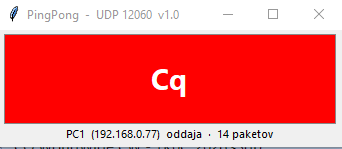

# PingPong – N1MM Logger+ UDP 12060 Lamps

> **Version:** 1.16 · Made by **S55OO** with AI assistance.

Shows which computer/station on the network is currently **transmitting**.
It listens to the N1MM Logger+ external UDP broadcast (XML) on port **12060**
and displays the caption of the pressed function key in that station's color.

Two tools are provided:

| File | What it is |
|---|---|
| `n1mm_lamps.py` / `n1mm_lamps.exe` | **Lamp** – small window that lights up in the color of the station on transmit |
| `n1mm_watch.py` / `PingPong.bat` | **Watcher** – detailed log of all packets (debug/analysis) |

---

## Screenshot



---

## 1. N1MM Logger+ setup

1. On each N1MM Logger+ PC: **File → Settings → Configurer →
   External Broadcast**, enable the reports you need (**RadioInfo**,
   **ContactInfo**, **Spot**, **AppInfo**, **dynamicresults** …).
2. **Broadcast Address**: your subnet broadcast (e.g. `192.168.178.255`)
   so every PC sees every station. Use the address of whichever network
   you run on – **LAN or VPN** – and match it in N1MM on every PC.
3. **Broadcast Port**: `12060` (default, do not change).
4. Per N1MM: **“Broadcast Data” must also be enabled on the other
   computers** (e.g. Run2), otherwise they send nothing.

> The app listens on all interfaces and **discovers stations
> automatically** – no per-PC IP configuration is needed. It follows the
> traffic that N1MM broadcasts, whether that arrives over your LAN or a
> VPN link.

### Network discovery (v1.5)

- **All adapters are detected reliably.** The lamp reads every active IPv4
  address of the PC (wired LAN, Wi-Fi, VPN) directly from Windows, so it
  always recognises its *own* N1MM station, even with Ethernet and Wi-Fi
  active at the same time. It re-checks every 30 s, so switching networks
  is picked up while running.
- **PingPong PCs find each other.** Every lamp broadcasts a small
  `PingPongHello` packet every 3 s on each adapter, on UDP port **46070**
  (v1.5–v1.8 used 12070, which collides with N1MM's own multi-computer
  networking and can make N1MM show an `IndexOutOfRangeException` in
  `MultiOpManager` – update all PCs to v1.9 or newer)
  (separate from 12060, so N1MM and other loggers never see it). A PC that
  runs PingPong but whose N1MM traffic does not reach you shows up in the
  footer:

  | Footer | Meaning |
  |---|---|
  | `RUN2: N1MM ne pride sem` | N1MM runs on RUN2 but its broadcast doesn't reach this PC – check the **Broadcast Address** in RUN2's N1MM |
  | `RUN2: ni N1MM` | PingPong runs on RUN2, but N1MM there isn't broadcasting |

- Change the port with `--discovery-port`, or turn it off with
  `--no-discovery`. All PCs must use the same discovery port.
- If Windows Firewall asks on first start, allow **private networks**.

> N1MM only broadcasts the key **caption** (e.g. `F1 CQ`), not the
> expanded CW/text. `Freq` in `RadioInfo` is in units of 10 Hz:
> Freq=701500 means 7015.00 kHz.

---

## 2. Lamp (n1mm_lamps.py / n1mm_lamps.exe)

### Behavior

- The lamp lights up **exactly as long as the station is actually
  transmitting**: it turns on at `IsTransmitting=True` and turns off
  immediately at `False`.
- The window shows the text of the last pressed function key (the `Fx`
  prefix is stripped).
- The window is always on top (`topmost`).
- A small **help icon** (top-right) opens this documentation in your default
  browser.

### Group key (band + mode)

The window shows **only transmissions from stations on the same band and
mode as the local computer** (the one running the window):

- Bands: **1.8, 3.5, 7, 14, 21, 28** MHz
- Modes: **CW, RTTY, SSB** (N1MM may report phone as `SSB`, `USB` or
  `LSB` – all count as SSB)

Example: PC1, PC2, PC3 on 14 MHz CW → colors alternate nicely. If PC4 is on
e.g. 7 MHz CW, its transmissions are **never** shown in this window, and
vice versa.

- The key follows the local station automatically when it changes band/mode
  (the footer shows `watching 14 CW`).
- A station on none of these bands/modes is never displayed.

### Running

```bat
        double-click:  n1mm_lamps.exe     (standalone executable)
   or:  run:  pythonw n1mm_lamps.py       (from source, no window)
```

Arguments:

```bat
python n1mm_lamps.py [--port 12060] [--stale 5.0] [--config lamps.cfg]
                     [--discovery-port 46070] [--no-discovery]
```

- `--port` – UDP port (default 12060).
- `--stale` – safety fallback in seconds; if no packet arrives from the
  transmitting station within this time, the lamp turns off (default 5.0).
- `--config` – path to `lamps.cfg`.
- `--discovery-port` – UDP port for PingPong-to-PingPong discovery
  (default 46070, `0` = off).
- `--no-discovery` – don't send or listen for discovery hellos.

### F12 call (Options menu, v1.12+)

Signal the other operators on your band without transmitting. Turn on
**Options ▾ → F12 call – blink S&P stations on my band** on every PC
(saved per PC).

- Press **F12 while N1MM's window is active** → your call is **on**. Your
  lamp gets a thick border in your color and the footer shows
  `F12 klic VKLOP (14 MHz) – F12 = izklop`.
- Every other PingPong PC that is **on the same band** and in **S&P**
  (N1MM's `IsRunning = False`) **blinks** in your color with
  `F12 · <your station>`.
- Press **F12 again** → the call is off and the blinking stops. It also
  stops if your lamp closes, or when the other PC changes band or goes
  to Run.
- N1MM still receives F12 normally (PingPong only watches the key; it
  doesn't block it). F12 in other programs is ignored.
- The call is sent immediately (normally within a fraction of a second).
- On a blinking lamp, **click the lamp** to silence that call there
  (footer: `klik = utišaj`). A new F12 call blinks again.
- Only **one lamp per PC** can run (v1.13+); starting a second one just
  says PingPong is already running.
- Real transmissions still take priority on the lamp.
- If N1MM runs **as administrator**, PingPong must too (Windows hides
  key presses of elevated programs from normal ones).

### Block my keys during a call (Options menu, v1.14+)

**Options ▾ → Block my F-keys while another station calls (F12)** – set
on the PCs that should be stopped (saved per PC, off by default).

- While this PC's lamp blinks for an F12 call (same band, S&P), N1MM's
  function keys **F1–F11** are swallowed – only at that time. The lamp
  shows `BLOKIRANO · F1` and the footer `F-tipke blokirane še 35 s`.
- All other keys work normally: **Esc**, Enter, letters, F12 and Alt
  combinations (Alt+F4…) are never blocked.
- Blocking ends as soon as the caller presses F12 again, or when you
  **click the lamp** (silence), change band, or go to Run – and **by
  itself after 40 s** if the caller forgets (the lamp keeps blinking,
  footer `blokada potekla`).
- Only works while N1MM is the active window. It does **not** stop mouse
  clicks on N1MM's F-key buttons, microphone PTT, paddle or footswitch –
  it is a guard against accidental key presses, not a hardware
  interlock.
- With Diagnostics on, each blocked key is written to `pingpong_test.log`.

### Diagnostics (Options menu)

**Options ▾ → Diagnostics (log to file)** writes what the lamp sees to
`pingpong_test.log` next to the exe. Use it when something doesn't work
as expected; it changes nothing on the lamp display.

- Every packet from this PC's N1MM: time, key caption, transmit state,
  frequency, mode.
- The state each other PingPong PC reports (band, Run/S&P, F12 call and
  blocking options, calls it sees, whether its F-keys are blocked).
- F12 presses, blocked keys and keyboard-watcher events.
- Off by default and not saved – it is always off when the lamp starts,
  so the log only grows while you are diagnosing. Delete the file any
  time.

### My color (Options menu, v1.7+)

**Options ▾ → My color…** lets each PC choose the color its own station
has on **every** PingPong lamp in the network.

- Colors already chosen by other PCs running PingPong are greyed out and
  show that PC's name, so two PCs can't pick the same one.
- The choice is announced in the discovery hello (UDP 46070), so all lamps
  use it – it overrides `lamps.cfg` and the order-of-appearance colors.
- If two PCs end up with the same color anyway (e.g. one was offline when
  the other chose), the PC that chose it **first** keeps it. The other
  falls back to an automatic color and its footer shows
  `barva <color> je zasedena (<PC>)` until you pick another one.
- **Automatic** removes the choice. Stations without a chosen color still
  get palette colors as before, but never a color another PC has chosen.
- Saved per PC in `pingpong.ini`. Only PCs running v1.7 or newer can
  choose a color; their choice is shown only on v1.7+ lamps.

### Updates and switching back (Options menu, v1.6+)

Click **Options ▾** (top-right of the lamp window):

| Item | What it does |
|---|---|
| **Check for updates** | Looks for a newer release on GitHub; offers to install it. |
| **Switch version…** | Pick any released version (newer or older) and install it. |
| **Revert to previous version (vX)** | Switches back to the version you had before the last switch – no download needed. Use this if a new version has a bug. |
| **Check for updates at startup** | On by default. Checks GitHub ~3 s after the lamp starts. |
| **Install updates automatically** | Off by default (you are asked first). When on, a newer release found at startup is installed without asking. |

How it works: the new `n1mm_lamps.exe` is downloaded next to the current
one and verified against the release's SHA-256 checksum. The running exe is
renamed to `n1mm_lamps.v<old version>.exe` (the backup for **Revert**), the
new one takes its place and the lamp restarts by itself. `lamps.cfg` is not
touched. Only one backup is kept. Settings are stored per PC in
`pingpong.ini` next to the exe.

- Updating only works in the **exe**, not when running `n1mm_lamps.py`.
- Updates are checked only at startup, never while running – the lamp
  never restarts in the middle of operating.
- Versions **before 1.6 have no Options menu.** If you switch back to one
  of those, return by double-clicking the kept backup
  (`n1mm_lamps.v1.6.exe` or newer) or by downloading the latest release.
- The PC needs internet access to github.com for updates; without it the
  lamp works normally and the check is silently skipped.

### lamps.cfg (optional)

Automatic station detection works **even without** this file. Stations
are assigned colors **in order of appearance**: the first detected station
gets **red**, the second **orange**, the third **light blue**, the fourth
**light green**, and so on through the rest of the palette (purple, cyan,
gold, pink, brown, lime green).

To assign stable labels/colors manually, each line is:

```
IP,label,color
```

Example:

```
192.168.178.55,PC1,red
192.168.178.56,Run2,orange
192.168.178.57,Run3,light blue
192.168.178.58,Run4,light green
```

- Lines starting with `#` are skipped.
- When a new station is detected that is **not** in `lamps.cfg`, the app
  assigns it the next unused palette color **in order of appearance** and
  **writes the entry back to `lamps.cfg`** automatically, so the color stays
  fixed on the next run. Edit the file any time to override a label/color.
- `n1mm_lamps.exe` reads `lamps.cfg` from the **same folder as the exe**.

---

## 3. Watcher (n1mm_watch.py)

Detailed view of all UDP traffic: station table on the left, traffic on the
right, detail/hex of the selected packet at the bottom.

```bat
        double-click:  PingPong.bat
```

```bat
python n1mm_watch.py [--port 12060] [--bind 0.0.0.0] [--log FILE] [--selftest]
```

- **Stop/Listen** button – toggles listening.
- **Freeze** – stops adding rows (traffic still recorded).
- **Autoscroll** – follows the latest packet.
- **Hex/raw** – shows packet details as hex + raw XML.
- **Log to file** – JSON lines into `n1mm_pingpong.log` (default next to
  the script; change with `--log`).
- **Clear** – empties the display.
- `--selftest` – verifies parsing with sample packets.

---

## 4. Building the standalone EXE (for PCs without Python)

Requires Python + PyInstaller:

```bat
python -m pip install pyinstaller
python -m PyInstaller --onefile --windowed --noupx --name n1mm_lamps --manifest manifest.xml n1mm_lamps.py
copy /Y dist\n1mm_lamps.exe n1mm_lamps.exe
```

`manifest.xml` makes the window use modern common controls. The result is a
single `n1mm_lamps.exe` (no Python required) – copy it to the other
computers together with the (optional) `lamps.cfg`.

**Antivirus false positives:** a locally-built EXE can get flagged by
Windows Defender / other AV engines – PyInstaller's prebuilt bootloader
and UPX-compressed binaries are both common heuristic triggers, even
though the EXE is clean. The command above already disables UPX
(`--noupx`), and the released EXE is built by the
[**Build n1mm_lamps.exe**](.github/workflows/build-exe.yml) GitHub Actions
workflow, which compiles the PyInstaller bootloader **from source** on a
clean Windows runner – the actual fix for the prebuilt-bootloader
fingerprint – and runs a Defender scan on the fresh build as a sanity
check. Prefer a release download over a local build if AV flags one.

**Releases are automatic.** On every push to `main` the workflow reads
`__version__` from `n1mm_lamps.py`. If release `v<version>` doesn't exist
yet, it creates the tag and release and attaches the freshly built EXE.
Release notes come from `releases/v<version>.md` (falls back to
GitHub-generated notes). To publish a new version: bump `__version__`, add
`releases/vX.Y.md`, push to `main`. Existing releases are never
overwritten.

---

## 5. Files

```
n1mm_lamps.py    – lamp (source code)
n1mm_lamps.exe   – lamp (standalone, no Python needed)
lamps.cfg        – optional: IP,label,color (auto-written on first discovery)
n1mm_watch.py    – traffic watcher
PingPong.bat     – watcher launcher
manifest.xml     – PyInstaller manifest (common controls)
help.png         – help icon shown in the lamp window (embedded in the exe)
pingpong_update.py – self-update / switch-version logic (built into the exe)
pingpong_keys.py – F12 key watcher for the F12 call (built into the exe)
pingpong.ini     – per-PC settings: chosen color, updates (created when changed)
n1mm_lamps.vX.exe – backup kept by the updater for "Revert"
n1mm_lamps.spec  – last PyInstaller build settings
dist\            – PyInstaller output (current n1mm_lamps.exe)
```
