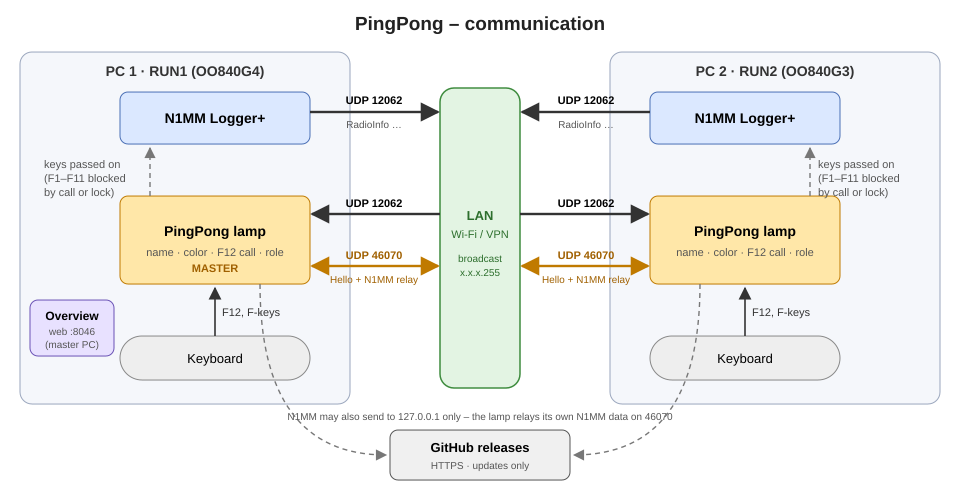
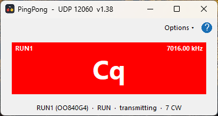
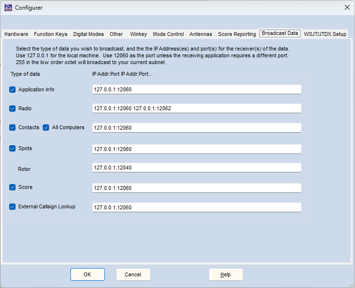
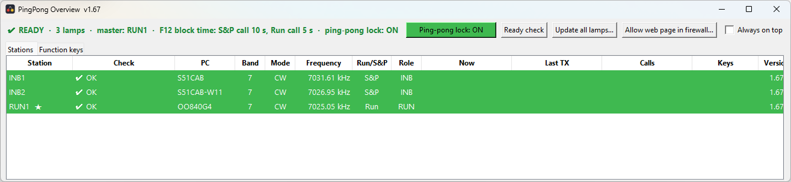
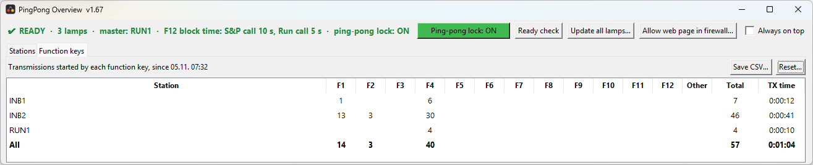

# PingPong – N1MM Logger+ Lamps

> **Version:** 1.80 · Made by **S55OO** with AI assistance.
> **Download:** [latest release](https://github.com/s55oo/N1MMPingPong/releases/latest) – `n1mm_lamps.exe` (every PC) and `pingpong_overview.exe` (master PC), no Python needed.
> **In short:** what PingPong does, on one page – [docs/SUMMARY.md](docs/SUMMARY.md).

PingPong shows which computer/station on the network is currently
**transmitting**. It listens to the N1MM Logger+ external UDP broadcast
(XML) on port **12062** and lights a small always-on-top lamp in that
station's color, with the caption of the function key that started the
transmission.

On top of that the lamps talk to each other, so operators can:

- give every PC its **own name and color**, the same on all lamps – one
  lamp is the **master** (it follows N1MM's network master) and hands out
  the automatic colors;
- send an **F12 call** that makes the S&P stations on the same band blink,
  and optionally **block their F-keys** – a call from a **Run** station
  reaches **all** stations on the band, with its own, shorter block time
  (both set on the master);
- send an **urgent call** with **Shift+F2** or **Shift+F4**: every station on the same
  band and mode flashes fast, Run or S&P, while your F2/F4 message is sent;
- use the **ping-pong lock**: RUN and inband stations (INB) on one band
  take turns, like with an interlock box – the role comes from N1MM
  (Run = RUN, S&P = INB), the lock is switched on/off on the master;
- see every station also when N1MM only sends to `127.0.0.1` or the PCs
  are only connected over a VPN such as ZeroTier – each lamp **passes its
  own N1MM's data on** to the other lamps;
- **update** all PCs from GitHub – one click in the Overview – and switch
  back to an older version.

The **Overview** on the master PC shows all stations in one live table
(also as a web page for phones), checks before the contest that every
station is ready, and counts the function keys per station.

All PCs should run the **same PingPong version**.

How the PCs, lamps and N1MM talk to each other – ports, messages, the
F12 call step by step, updates – is described with diagrams in
**[docs/COMMUNICATION.md](docs/COMMUNICATION.md)**.



Three tools are provided:

| File | What it is |
|---|---|
| `n1mm_lamps.exe` / `n1mm_lamps.py` | **Lamp** – small window that lights up in the color of the station on transmit |
| `pingpong_overview.exe` / `pingpong_overview.py` | **Overview** – live table of all stations, in a window and as a web page for any browser (for the master PC) |
| `PingPong.bat` / `n1mm_watch.py` | **Watcher** – detailed list of all N1MM packets (debug/analysis, needs Python) |

---

## Screenshot



*RUN1 (PC OO840G4, role RUN) is transmitting `CQ` on 7016.00 kHz CW.*

---

## 1. N1MM Logger+ setup

1. On each N1MM Logger+ PC: **Config → Configure Ports, Mode Control,
   Winkey, etc… → Broadcast Data** tab. Tick **Radio** (required) and any
   other data you want (Application Info, Contacts, Spots, Score …).
2. In the **Radio** line add **`127.0.0.1:12062`** – the lamp listens on
   **UDP 12062** (since v1.76; before it was 12060). A line takes several
   destinations separated by spaces, so other programs that use N1MM's
   usual 12060 (e.g. **Callbooker**) keep working:

   ```
   127.0.0.1:12060 127.0.0.1:12062
   ```

   Only the **Radio** line needs 12062 – PingPong reads only N1MM's
   `RadioInfo`. Leave the other lines (Application Info, Contacts, Spots,
   Score, External Callsign Lookup) as they are. Click **OK**.

   

   That is enough: the lamp on the same PC passes this PC's N1MM data on
   to all other lamps, on **every** network both PCs are on (LAN, Wi-Fi,
   ZeroTier, other VPNs). You can also add your subnet broadcast on 12062
   (e.g. `192.168.178.255:12062`); then lamps on that LAN get it directly,
   which they prefer.
3. **"Broadcast Data" must be enabled on every N1MM PC** (e.g. Run2 too),
   otherwise that PC sends nothing.

If the lamp hears nothing from its own N1MM for 30 s, the line under it
says `no data from this PC's N1MM on UDP 12062 – N1MM Broadcast Address
must include 127.0.0.1:12062` (and the Overview's ready check shows
`no N1MM data on UDP 12062`).

### Another program on the same port

If two programs on one PC listen on the **same** UDP port, Windows gives
each packet N1MM sends to `127.0.0.1` to **only one** of them – the lamp
then misses this PC's N1MM, and so do all other lamps (the lamp passes
its own N1MM on). That's why the lamp uses its own port 12062. If another
program uses 12062 too, the line under the lamp says, in red,
`⚠ UDP 12062 also used by … – N1MM data may be missing here`.

Fix: give one of them another port and add it to N1MM's Broadcast
Address, e.g. start the lamp with `n1mm_lamps.exe --port 12063` and add
`127.0.0.1:12063`.

What N1MM reports – and therefore what PingPong can show:

- `IsTransmitting` is **True only for transmissions N1MM starts itself**
  (function keys, Enter/Insert messages …). Keying with the microphone
  PTT, a paddle or a footswitch is **not** reported.
- `FunctionKeyCaption` is the label of the key that **started that
  transmission**. A key that sends nothing – an empty message, a single
  space, or only a command such as `{WIPE}` – is never reported.
- Phone mode is reported as `SSB` (or `USB`/`LSB`). `Freq` is in 10 Hz
  units: `Freq=701500` means 7015.00 kHz.

---

## 2. Lamp (n1mm_lamps.exe)

### Behavior

- The lamp lights up **exactly while a station transmits**: on at
  `IsTransmitting=True`, off immediately at `False`. It shows the key
  caption with the `Fx` prefix removed (`F1 CQ` → `CQ`).
- Text color adapts to the lamp color: black on light colors, white on
  dark ones.
- The lamp's top-right corner shows the **frequency of the transmitting
  station in kHz** (e.g. `14025.00 kHz`; also the caller's frequency
  during an F12 call).
- The lamp's top-left corner shows **who is sending on this band right
  now** (e.g. `OO840G3`), or `F12: <PC>` during an F12 call; empty when
  idle.
- The line under the lamp lists every station with band, mode and role,
  this PC first, e.g. `RUN1 14 CW RUN (me) · INB1 14 CW INB · PC5 7 SSB RUN`.
  Stations not heard for a minute drop off the list.
- While someone transmits it shows **name (hostname) · RUN/INB ·
  transmitting · band mode**, e.g.
  `INB1 (OO840G3) · INB · transmitting · 14 CW`.
- **RUN / INB** is the station's ping-pong role, which always follows
  N1MM's mode: **Run = RUN, S&P = INB**. The hostname is the PC's Windows
  name (shown when it differs from the name).
- The window is always on top. **Only one lamp per PC** can run; starting
  a second one just says PingPong is already running.
- **Options ▾** (top-right) holds all settings; the **help icon** next to
  it opens this page.
- **Right-click the lamp** also opens the Options menu.

### Compact mode (Shift+F)

Click the lamp and press **Shift+F** – or tick **Options ▾ → Compact
mode** – and the title bar, the top row and the
gray margins disappear – only the lamp is left, same size and place. The
status line moves onto the lamp's bottom edge (the sender's name and the
frequency are on the lamp anyway), so no information is lost.

- **Drag the lamp** with the mouse to move it.
- **Right-click** for the Options menu; a plain click still silences an
  F12 call.
- **Shift+F** again (or untick **Compact mode** in the right-click menu)
  brings back the normal window.
- The lamp **remembers its place and mode**: after a restart or update it
  comes back where it was, compact or not. If that place is no longer on
  a screen (e.g. a monitor was unplugged), it opens at the default place.

### Lamp size and night mode (Options ▾)

- **Lamp size: normal / large / extra large** – the lamp, its texts and
  the line under it grow (×1.4 / ×1.8), e.g. for an operator sitting
  further from the screen. Saved per PC.
- **Night mode (dim lamp colors)** – every lamp color at about half
  brightness, so a blinking or flashing lamp doesn't dazzle at night.
  Saved per PC.

### Band + mode group

A lamp shows **only transmissions on the same band and mode as its own
PC's N1MM**, so separate radios never clash:

- Bands: **1.8, 3.5, 7, 14, 21, 28** MHz
- Modes: **CW, RTTY, SSB** (`SSB`, `USB` and `LSB` all count as SSB)

Example: PC1, PC2, PC3 on 14 MHz CW share one lamp picture; PC4 on 7 MHz
CW is never shown on their lamps, and vice versa. The group follows this
PC automatically when it changes band or mode. Stations outside these
bands/modes are never shown.

### My name (Options ▾ → My name…)

Give this PC a short name, e.g. `RUN1` or `RUN2` (max 12 characters).

- The name is sent to all lamps, like the color: **every lamp shows
  `RUN1` instead of the N1MM computer name** – in the lamp corner, the
  line under the lamp and for F12 calls.
- A name already used by another PC is refused.
- Empty = use the N1MM computer name again. Saved per PC in
  `pingpong.ini`.

### My color (Options ▾ → My color…)

Each PC chooses the color of **its own station on every lamp**.

- Click one of the 10 palette colors, or **More colors…** for the Windows
  color picker.
- Colors already chosen by other PCs are greyed out and show that PC's
  name; a custom color **too similar** to another PC's color is refused.
- The choice is sent to all lamps and overrides everything else.
- If two PCs still end up with the same color (one was offline when the
  other chose), the PC that chose it **first** keeps it; the other uses
  an automatic color and shows `color <color> is taken (<PC>)`.
- **Automatic** removes the choice. Stations without a chosen color get
  their color from the **master** (see below), so it is the same on every
  lamp: red, orange, light blue, light green, purple, cyan, gold, pink,
  brown, lime green – never a color another PC has chosen.

### Master (follows N1MM)

One lamp is the **master**: it hands out the automatic colors for all
stations, and every other lamp uses its list.

- The master is the PC whose **N1MM is the network master**. Each lamp
  reads `IsNetworkMaster` from its own PC's N1MM settings
  (`Documents\N1MM Logger+\N1MM Logger.ini`) every few seconds. Switch the
  master in N1MM's Network Status window and PingPong follows.
- If no N1MM reports a master (N1MM not networked), the **lamp started
  first** is master.
- Colors are **sticky**: a station keeps its color while it is there,
  also when the master changes.
- The **title bar** shows the lamp's N1MM port before the version: the
  master's lamp says `PingPong - MASTER UDP 12062 v1.80`
  (the others just `PingPong UDP 12062 v1.80`), and the line under the lamp marks
  it: `RUN1 7 CW RUN (me, master)` or `OO840G3 7 CW RUN (master)`.
- The master also decides for every lamp: both **F12 block times** and
  **ping-pong lock on/off** (see below).
- **Two-master warning** – the line under the lamp turns **red**:

  | Warning | Meaning |
  |---|---|
  | `⚠ TWO MASTERS: RUN1, RUN2 – …` | two lamps both act as master: they don't hear each other (one-way firewall – **Allow PingPong in Windows Firewall…** on both), or one runs an old version. Colors and block times can differ until it's fixed. |
  | `⚠ N1MM master on RUN1 and RUN2 – …` | two N1MMs say they are network master. PingPong still picks one, but check N1MM's **Network Status** window. |

### F12 call (Options ▾ → F12 call – blink stations on my band (Shift+F2/F4 = urgent))

Warn the other operators on your band without transmitting.

- Turn the option on on **every PC that may call** (saved per PC).
- Press **F12 while N1MM is the active window** → your call is **on**:
  your lamp gets a wide **blinking border** in your color and counts
  down: `F12 · 18 s` on the lamp, `F12 call ON (14 MHz, S&P stations) ·
  18 s left – F12 = off` on the line under it.
- **Who is called depends on your mode when you press F12:**

  | You are in | Called on your band | Call lasts |
  |---|---|---|
  | **S&P** | only the **S&P** stations | **S&P call** block time (default 30 s) |
  | **Run** | **all** other stations, Run and S&P | **Run call** block time (default 5 s) |

- Each called PC **blinks** in your color with `F12 · <your station> · 18 s`
  (counting down to the end of the call), framed by a wide border in your
  color. PCs on another band are not affected.
- Press **F12 again** → the call is off everywhere. It also ends when
  your lamp closes; on a receiving PC it ends when that PC changes band,
  or (for an S&P call) goes to Run.
- The receiving PC also gives a short **double beep** when the call starts
  (once per call; **Options ▾ → Sound on F12 call**, on by default).
- On a blinking lamp, **click the lamp** to silence that call there
  (`click = silence`). A new F12 call blinks again.
- **S&P stations can't answer a call with their own.** While another PC's
  call runs on your band and you are in **S&P**, F12 on your PC is
  **ignored** (also if you silenced that call): the lamp shows
  `BLOCKED · F12` or `F12 busy · RUN1`, the line under it
  `F12 ignored – RUN1 is calling on 14 MHz`. Once that call ends, F12
  works again. A station in **Run** can always press F12, and ending
  your own call with F12 always works.
- N1MM still gets F12 (PingPong only watches it). Tip: give F12 a message
  that sends nothing, e.g. `F12 NULL, ` (a single space), so N1MM ignores
  it. F12 in other programs is ignored by PingPong.
- Real transmissions on the band still take priority on the lamp.

### Urgent call (Shift+F2 / Shift+F4)

For when everybody on the band must look **now**.

- Works on PCs with **F12 call** turned on in Options.
- Press **Shift+F2 or Shift+F4 while N1MM is the active window** → urgent call **on**.
  N1MM still gets the key and fires **F2 or F4 at the same time**, as usual.
- **Every** other PingPong PC on the **same band and mode**, Run or S&P,
  **flashes fast**: the lamp and its border swap between your color and
  white, and it shows **your name and the F2/F4 message**, e.g. `RUN1 · QRL?`
  (`RUN1 · MSG` until the caption arrives; no sound). It takes over the
  lamp, even over a transmission or an F12 call. The line under it says
  `URGENT call from RUN1 · 14 CW · while it transmits · click = silence`.
- It lasts **exactly while your F2/F4 message is being sent**: it ends as
  soon as N1MM stops transmitting (message done, or Esc). If N1MM starts
  no transmission within **3 s** (e.g. the key has no message), it ends by
  itself. There is no other time limit.
- Your own lamp's border flashes fast meanwhile.
- Pressing **Shift+F2** or **Shift+F4** again starts a new urgent call with that message.
- A **click on a flashing lamp** silences it on that PC.
- It does **not** block any keys. While your own F-keys are blocked (F12
  call or ping-pong lock), the urgent call still goes out, but N1MM
  doesn't get F2/F4.

### Block my F-keys (Options ▾ → Block my F-keys while another station calls (F12))

Turn this on on the PCs that should be **stopped** during a call (saved
per PC, off by default).

- While this PC's lamp blinks for an F12 call, N1MM's function keys
  **F1–F11** are swallowed. The lamp shows `BLOCKED · F1` when a key is
  stopped, the line under it `RUN1 calls (F12) · 14 MHz · 15 s left ·
  F-keys blocked`, and lamp and border **swap colors** back and forth.
- **Esc**, Enter, letters, F12 and Alt combinations always work;
  Shift+F2 / Shift+F4 still start an urgent call.
- A **Run call** also blocks Run stations – tick this option on the Run
  PCs too if they should be stopped.
- The block ends when the caller presses F12 again, when you click the
  lamp, change band or (S&P call) go to Run – and **by itself after the
  F12 block time**: then the whole call ends (blinking stops on all PCs,
  and the calling PC's call switches itself off).
- **Two F12 block times**, set **on the master only** (**1–30 s** each):
  **Options ▾ → F12 block time, S&P call…** (default **30 s**) and
  **Options ▾ → F12 block time, Run call…** (default **5 s**). The values
  go to all lamps at once; on other PCs the menu shows them greyed out,
  e.g. `F12 block time: S&P call 30 s, Run call 5 s (set on master RUN1)`.
  A new master keeps the current values.
- Only while N1MM is the active window. It does **not** stop mouse clicks
  on N1MM's buttons, microphone PTT, paddle or footswitch – it guards
  against accidental key presses, it is not a hardware interlock.

### Ping-pong lock

For the "ping-pong mode" of a multi-op station: one **RUN** station and
inband stations (**INB1**, **INB2** …) on the same band take turns – RUN
transmits, and in RUN's listening gap one inband station transmits. The
lock does in software what an interlock box does for this rule. N1MM
still prevents two real transmissions at the same time; PingPong adds the
alternation.

**The role always comes from N1MM** on each PC – **Run = RUN,
S&P = INB** – and changes the moment the operator switches mode in N1MM.
Nothing to set; **Options ▾** only shows the current role.

**On or off for everybody – on the master:** **Options ▾ → Ping-pong lock
(RUN first, inband stations take turns) – for all PCs** (on by default).
Untick it on the master and **nobody is locked** – every station may
transmit without priority; the value reaches all lamps at once. Other
PCs show it greyed out (`Ping-pong lock: OFF – everybody may transmit
(set on master RUN1)`). The same switch is in the **Overview** on the
master PC: the button **Ping-pong lock: ON** (green) / **OFF** – one click
switches it, the master's lamp passes it on to every lamp. A new master
keeps the current setting.

| Role | Behavior |
|---|---|
| **off** | N1MM's Run/S&P not known yet (e.g. just started): no lock. |
| **RUN** | Never locked. Every RUN transmission opens a new period for the inband stations. |
| **INB** | After RUN has transmitted, **the first INB that transmits takes the slot**; every other INB on that band is **locked until RUN transmits again**. The INB holding the slot may keep transmitting in it. |

- While locked, the INB's **F1–F11, Enter and Insert** are swallowed (Esc,
  letters, F12 and Alt combinations always work). The lamp shows who holds
  the slot and the seconds until the lock releases itself, e.g.
  `WAIT · INB1 · 32 s` (`BLOCKED · F1` when a key is stopped); the line
  under it says `slot taken by INB1 – wait for RUN (free in 32 s at the
  latest)`. RUN transmitting frees it earlier.
- **Several RUN stations** (e.g. a second RUN in Run mode): they are
  treated exactly the same. None of them is ever
  locked, and a transmission from **any** RUN on the band frees the slot.
- The lock applies only on the **same band**, only when a station in
  **Run** (role RUN) is on that band, and only while the lock is **ON** on
  the master. It releases itself if RUN stays silent for the **release
  time** – set on the master: **Options ▾ → Ping-pong release time…**,
  **0–40 s** (default **40 s**; **0** = never by time, only a RUN
  transmission frees the slot). The value reaches all lamps at once;
  other PCs show it greyed out, the Overview in its top line
  (`ping-pong lock: ON (release 40 s)`). With 0 the locked lamp shows
  `WAIT · INB1` without a countdown.
- **GO:** when RUN's transmission ends and the slot is free, every inband
  lamp shows a green **GO** for 3 s – the moment to transmit. It
  disappears as soon as an inband station takes the slot (the others then
  show `WAIT`). GO is visual only, without sound.
- **No RUN on the band:** an inband lamp says
  `ping-pong: no RUN on 7 MHz – lock off` (and the Overview's ready check
  shows it in red) – e.g. when the run station is in S&P by mistake.
- RUN's transmissions must be started by N1MM (F-keys, Enter/Insert) –
  a CQ keyed by paddle or PTT is not reported, so it does not free the
  slot (the release time still does, unless it is set to 0).
- Like the F-key block, it only stops key presses in N1MM (not mouse
  clicks, PTT or paddle).
- How it works step by step: [docs/COMMUNICATION.md](docs/COMMUNICATION.md#5-ping-pong-lock).

### Updates and switching back (Options ▾)

| Item | What it does |
|---|---|
| **Check for updates** | Looks for a newer release on GitHub and offers to install it. |
| **Switch version…** | Install any released version, newer or older. |
| **Revert to previous version (vX)** | Back to the version you had before the last switch, no download. Use it if a new version has a bug. |
| **Check for updates at startup** | On by default; checks ~3 s after the lamp starts. |
| **Install updates automatically** | Off by default (you are asked). When on, a newer release found at startup installs without asking. |

The new exe is downloaded next to the current one and checked against the
release's SHA-256 checksum. The running exe is renamed to
`n1mm_lamps.v<old version>.exe` (the backup for **Revert**; only one is
kept), the new one takes its place and the lamp restarts. `lamps.cfg` and
`pingpong.ini` are kept.

- Updates work in the **exe** only, not when running `n1mm_lamps.py`.
- Updates are checked only at startup – the lamp never restarts on its
  own while you operate. **Update all lamps…** in the Overview on the
  master PC updates every lamp at once (no question on the PCs; lamps
  from v1.60).
- Only the **last three versions** are kept on GitHub, so **Switch
  version…** lists just those. The backup of the version you had before is
  kept next to the exe (e.g. `n1mm_lamps.v1.67.exe`); double-click it to
  run it without installing.
- Without internet access the check is silently skipped.

### Windows Firewall (Options ▾ → Allow PingPong in Windows Firewall…)

Adds an inbound rule `PingPong lamps UDP` for UDP **12062** (N1MM data) and **46070**
on private and domain networks. Windows asks for administrator rights
(UAC); an older rule with the same name is replaced. Do it once per PC,
if the lamp says `no PingPong heard – firewall?`.

### Diagnostics (Options ▾ → Diagnostics (log to file))

Writes what the lamp sees to `pingpong_test.log` next to the exe – use it
when something doesn't work as expected. It changes nothing on the lamp.

- every `RadioInfo` packet – from this PC's N1MM and from other PCs,
  marked `(direct)` or `(relayed)` (time, station, key caption, transmit
  state, frequency, mode, Run);
- the state every other PingPong PC reports (band, Run/S&P, F12 call and
  block options, calls it sees, whether its F-keys are blocked, **which
  stations it sees**, whether it shares its N1MM);
- F12 presses, urgent calls, blocked keys and keyboard-watcher events;
- ping-pong events (`slot taken by INB1`, `RUN transmits – slot free`,
  `lock ON/off`, role changes) and commands from the Overview;
- the **full text** of this PC's N1MM packets (`XML: …` lines; RadioInfo
  only when something besides transmit state/key changed; spots skipped)
  – for finding out which fields N1MM sends.

Unexpected errors are always written to `pingpong_error.log` next to the
exe – send that file if something stops working. The lamp keeps running:
an error never stops its display or its messages to the other lamps.

Always off after a restart, so the log only grows while you diagnose.
Delete the file any time.

### Command line (optional)

```bat
n1mm_lamps.exe [--port 12062] [--stale 5.0] [--config lamps.cfg]
               [--discovery-port 46070] [--no-discovery]
```

- `--port` – UDP port for this PC's N1MM data (default 12062; N1MM's
  Broadcast Address must include `127.0.0.1:<port>`).
- `--stale` – safety fallback in seconds: if the transmitting station
  sends nothing for this long, the lamp turns off (default 5.0).
- `--config` – path to `lamps.cfg` (default: next to the exe).
- `--discovery-port` – port the lamps use to talk to each other
  (default 46070, `0` = off). Must be the same on all PCs.
- `--no-discovery` – no lamp-to-lamp messages (no colors, F12 call or
  network notes).

### How the lamps find each other and share N1MM data

- Every lamp sends a small `PingPongHello` message every 3 s (at once
  after an F12 press) as a broadcast on every network adapter of the PC –
  LAN, Wi-Fi, VPN – on UDP port **46070**. This port is separate from
  N1MM's ports on purpose: N1MM must never receive these messages.
- The lamp reads all of the PC's IPv4 addresses directly from Windows and
  re-checks them every 30 s, so it always recognises its **own** N1MM
  station (also when N1MM sends to `127.0.0.1`).
- **Sharing N1MM data:** each lamp forwards its **own** N1MM's
  `RadioInfo` to the other lamps on port 46070, on every network. So a
  station is seen even if its N1MM only sends to `127.0.0.1`, or to a LAN
  the other PC isn't on (e.g. over ZeroTier). If N1MM's own broadcast also
  arrives, the lamp uses that and ignores the forwarded copy; every PC
  appears once. **Options ▾ → Share my N1MM with other lamps** (on by
  default).
- A PC running PingPong whose N1MM traffic doesn't arrive is listed under
  the lamp:

  | Note | Meaning |
  |---|---|
  | `RUN2: N1MM not reaching here` | N1MM runs on RUN2 but its data doesn't reach this PC – check that **Share my N1MM with other lamps** is on on RUN2 and RUN2's lamp is up to date, or check RUN2's **Broadcast Address** |
  | `RUN2: no N1MM` | PingPong runs on RUN2, but its N1MM isn't broadcasting |
  | `RUN2: v1.67 – update it` | RUN2 runs an older PingPong – update it (Overview: **Update all lamps…**) |
  | `RUN2: v1.77 – update this PC` | RUN2 is newer than this lamp – update this PC |
  | `PC5: no PingPong lamp there` | N1MM on PC5 is heard, but no lamp runs there (other lamps are heard fine) |
  | `PC5: no PingPong heard – firewall?` | N1MM data arrives, but **no** other lamp is heard at all – this PC's firewall probably blocks UDP 46070. Use **Options ▾ → Allow PingPong in Windows Firewall…** |

  The last two notes appear only 30 s after the lamp started.

### lamps.cfg (optional)

Not needed – stations are detected automatically. To give stations fixed
labels/colors, put a `lamps.cfg` next to the exe with one line per station
(see `lamps.example.cfg`):

```
IP,label,color
192.168.178.55,PC1,red
192.168.178.56,Run2,orange
```

Lines starting with `#` are skipped. The lamp never writes this file
(automatic colors come from the master). A color in the file is used only
for a station whose PC runs no lamp and isn't in the master's list yet;
**My color…** always wins.

### Settings file: pingpong.ini

Written next to the exe when you change something in **Options**; one per
PC, kept by updates.

| Section | Keys |
|---|---|
| `[update]` | `check_at_startup`, `install_automatically`, `f12_call`, `block_keys`, `call_sound`, `share_n1mm` |
| `[station]` | `alias` (My name), `color`, `color_time` (when the color was chosen – the earliest choice wins a conflict), (an old `role` entry is ignored – the role comes from N1MM) |
| `[network]` | `block_time`, `block_time_run` – F12 block times (S&P call, Run call); `pingpong` – ping-pong lock yes/no; `pp_limit` – ping-pong release time (0–40 s); all last received from the master |
| `[window]` | `x`, `y`, `compact` – where the lamp was and whether it was in compact mode; `size` (normal / large / xlarge), `night` (yes/no) |
| `[n1mm]` | optional `ini` – path of N1MM's settings file, if it isn't in the usual `Documents\N1MM Logger+` folder |

---

## 3. Overview (pingpong_overview.exe)

A separate program for the **master PC**: one live table of every
PingPong station.

**Start it from the master's lamp:** **Options ▾ → Open PingPong
Overview…**. The item is active only on the master's lamp; on other PCs
it is greyed out and names the master. The lamp starts
`pingpong_overview.exe` from its own folder. If the exe is not there, the
lamp offers to download it from the
[latest release](https://github.com/s55oo/N1MMPingPong/releases/latest)
(checked by size and SHA-256), saves it next to `n1mm_lamps.exe` and
starts it. Only one Overview runs per PC; a second start says it is
already running. (Lamps accept the Overview's commands only from the
master PC anyway.)



*Ready check before the start: RUN1 (master ★, in Run) and the inband
stations INB1 and INB2 (in S&P) on 7 MHz CW – all green, `✔ READY`,
ping-pong lock ON, every lamp on the newest version (`All lamps v1.68 ✔`).*

| Column | Shows |
|---|---|
| Station | name (My name, else PC name); **★** = master |
| Check | `✔ OK`, or what is not ready (see *Ready check*) |
| PC, Version | Windows name and PingPong version |
| Band, Mode, Frequency, Run/S&P | from that PC's N1MM |
| Role | ping-pong role (RUN / INB / –) |
| Now | `TX <message> (time)` while it transmits – the row is in the station's color |
| Last TX | last message and how long ago |
| Calls | `F12 S&P call` / `F12 Run call` (row yellow), `URGENT` (row flashes red) |
| Keys | `F-keys blocked`, `ping-pong WAIT`, `holds slot` |
| Ping | round-trip time to that lamp over PingPong's own protocol, e.g. `3.2 ms`; `lost` = no answer (see *Ping*) |
| Seen | time since that lamp was last heard (grey after 12 s) |

Above the table: number of lamps, the master, both F12 block times and
`ping-pong lock: ON/OFF` – or a red `⚠ TWO MASTERS`. Below it: different
versions, who holds the ping-pong slot per band, and lamps whose N1MM data
doesn't arrive.

The top of the window has **two rows**, so it can stay narrow (the status
text wraps, the table scrolls sideways when needed):

- **row 1:** the status text, and to its right the contest buttons
  **Ping-pong lock: ON/OFF**, **Ready check**, **Test all lamps**, **Emergency ▾**;
- **row 2, maintenance:** **Update all lamps…** (shows `Update 2 lamps…` /
  `All lamps v1.80 ✔`), the yellow **Update Overview to vX…** (only when a
  newer Overview exists), **Allow web page in firewall…** (hidden once the
  rule exists), **Always on top**.

**Ready check.** When the Overview starts, every station's row is
**green** (ready) or **dark red** (a problem, shown in **Check**), until
that station **transmits for the first time** – from then on its row is
colored as usual (station color while transmitting, yellow for an F12
call …). The line above the table says `✔ READY` or
`✖ NOT READY (2 of 3)`. Press **Ready check** to start it again (e.g. before
day two). Checked for each lamp:

- heard on the network (`not heard for …`);
- same version as the newest lamp / the newest release on GitHub
  (`v1.59 – update to v1.60`);
- N1MM data arrives and its band/mode is supported (`no N1MM data`);
- exactly one master (`no master`, `two masters`);
- keyboard watcher running where F12 call, F-key block or INB needs it;
- **problems the lamp reports itself:** no data from its N1MM on UDP 12062, another program on that port
  (e.g. Callbooker), keyboard watcher not running, errors in
  `pingpong_error.log`, `ping-pong: no RUN on 7 MHz` (lamps v1.69+).

**Ping-pong lock: ON / OFF** (button, green when on) switches the
ping-pong lock for all PCs with one click: the master's lamp takes it and
passes it on to every lamp – the same as the switch in the master lamp's
Options (the master's lamp must be v1.67 or newer).

**Update all lamps…** asks every lamp to download the newest release from
GitHub and restart – no need to go to each PC. The button shows the
version state: **Update 2 lamps…** when some lamps are behind (the dialog
lists them), **All lamps v1.80 ✔** when every lamp is current – then a
click only tells you so and nothing is sent. Lamps accept commands
**only from the master PC** (where the Overview runs) and only from
**v1.60** on; older lamps must be updated by hand once.

**Function keys tab.** For every station: how many transmissions each
function key **F1–F12** started, **Other** (a caption without an F-key
number), **Total** and the total **TX time** – plus an **All** row.



- Counted when N1MM reports a transmission start with that key's caption,
  so keys that send nothing are not counted. Messages sent with Enter
  (ESM) count under their F-key.
- Kept per PC in `pingpong_stats.json` next to the exe (saved every 30 s
  and on close), so a restart during the contest loses nothing.
- **Save CSV…** exports the table (for Excel: `;`-separated);
  **Reset…** sets everything to zero, e.g. before the contest starts.

**Emergency ▾ – for emergencies only.** Two commands for every lamp:

- **Restart all lamps…** – each lamp closes and starts again (a few
  seconds without lamps), e.g. if lamps hang or behave wrongly.
- **Stop all lamps…** – each lamp is **closed**: no lamps, no F12 calls,
  no ping-pong lock until each lamp is started again by hand on its PC.

Both ask twice: first **Yes / No**, then you must **type `YES`** and press
**Enter** – anything else cancels and nothing is sent. Like the other
commands they are accepted only from the master PC (lamps v1.71+).

**Test all lamps** – every lamp flashes its **own name and role** for 3 s
(purple/white, `TEST` in the corner), e.g. `INB2 · INB`. Before the start
you see at a glance that every PC is reachable and which lamp is which –
nothing is transmitted, nothing is blocked (lamps v1.72+).

**Ping.** Every **5 minutes** – and at once with **Ping now** on the
Activity tab – the Overview sends a ping to all lamps over PingPong's own
protocol (UDP 46070); each lamp answers at once and the Overview measures
the **round-trip time** in ms. It shows in the **Ping** column (one
decimal below 10 ms), as **Ping avg / max / lost** per station on the
Activity tab, and in the ready check: `no ping reply` or `slow network`
(over 500 ms) turns the row red. Lost and slow pings go into the event
log. Lamps answer only the master PC, from v1.73 on (older lamps show
nothing, not "lost").

**Activity tab.** Per station: how often it had to **wait** (ping-pong
`WAIT`) and for how long in total, how many **F12** and **urgent calls** it
made, its total **TX time**, its **ping** (average, maximum, lost) – and a chart of **TX minutes per hour**
(darker = more transmitting; the last 12 hours with activity). Reset and
**Save CSV…** on the Function keys tab cover these too.

**Event log.** The Overview writes the contest timeline to
`pingpong_events.csv` next to the exe (`;`-separated – opens in Excel):
`date;time;station;event;details`, e.g.

```
2026-11-28;03:12:40;INB2;ping-pong WAIT;
2026-11-28;03:12:52;INB2;ping-pong free;waited 12 s
2026-11-28;03:14:05;RUN1;F12 call;Run call, 7 MHz
2026-11-28;03:20:11;INB1;lamp not heard;for 13 s
2026-11-28;03:20:30;INB1;lamp restarted;v1.72
```

Logged: lamps on / restarted / not heard / heard again, F12 and urgent
calls, ping-pong WAIT and free, master changes, ping-pong lock and
release time changes, and the commands sent from the Overview (update,
test, ping-pong, emergency). **Open event log** on the Activity tab
opens it. Delete the file any time; it starts again with a header.

**Web page.** The same tables are served at `http://<master PC>:8046` –
open it in any browser on the network, also on a **phone or tablet**
(nothing to install; it updates every second). The addresses are shown at
the bottom of the window. Other devices can open it once Windows allows
it: click **Allow web page in firewall…** in the window (asks for
administrator rights; rule `PingPong Overview web page`, TCP 8046). When
the Overview finds that rule, the button disappears and the status text
(row 1, after the ping-pong lock) shows `web 0.0.0.0:8046` – the web page
is open to the network.

- It **listens** to the lamps (UDP 46070) and sends them only the two
  commands above (update, ping-pong lock on/off). It never opens N1MM's
  ports (12060, 12062), so it can run next to the master's lamp without taking
  N1MM's packets away.
- It shows stations whose PC runs a PingPong lamp with **Share my N1MM
  with other lamps** on (the default).
- `pingpong_overview.exe [--discovery-port 46070] [--web-port 8046]`
  (`--web-port 0` = no web page). Window place and **Always on top** are
  kept in `pingpong_overview.ini` next to the exe.
- **Updates itself:** at start (and every 30 min) it looks for a newer
  release. If there is one, it asks once, and the yellow **Update
  Overview to vX…** button stays visible – it downloads the new
  `pingpong_overview.exe`, checks it (size, SHA-256) and restarts; the
  statistics and window settings are kept.

---

## 4. Troubleshooting

| Problem | What to check |
|---|---|
| `no data from this PC's N1MM on UDP 12062` | N1MM's **Broadcast Data → Radio** line must include `127.0.0.1:12062` (e.g. `127.0.0.1:12060 127.0.0.1:12062`) – see [N1MM Logger+ setup](#1-n1mm-logger-setup). |
| Red `⚠ UDP 12062 also used by …` | Another program takes N1MM's packets – see [Another program on the same port](#another-program-on-the-same-port). |
| Lamp never lights | **Broadcast Data** and **RadioInfo** enabled in N1MM, correct **Broadcast Address**; band/mode in the list above; the lamp only lights for N1MM-started transmissions (not mic PTT/paddle). |
| My own transmissions don't show | The lamp shows only *your band and mode* – check the line under the lamp shows your station. |
| A key doesn't show | That key sends nothing (empty message, `{WIPE}` …) – N1MM doesn't report it. |
| Other PCs don't blink on F12 | All PCs on the same version; same **band**; an F12 from S&P reaches only **S&P** stations (from Run: all); **F12 call** option on, F12 pressed while N1MM is active; **Diagnostics** on the calling PC shows what the other PCs report. |
| Ping-pong lock never locks | **Ping-pong lock: ON** (Overview / master's Options); a station in **Run** on the same band; the inband stations in **S&P** – check the **Role** column in the Overview. |
| An INB stays locked although RUN transmits | RUN's messages must be N1MM-started (F-keys, Enter) – paddle/PTT are not reported; the lock releases itself after the release time (master's Options, 0–40 s; 0 = never by time). **Diagnostics** on the locked PC shows the slot events. |
| One PC never receives the other lamps | Windows Firewall on that PC must allow UDP 12062 and 46070: **Options ▾ → Allow PingPong in Windows Firewall…**, or as administrator: `netsh advfirewall firewall add rule name="PingPong lamps UDP" dir=in action=allow protocol=UDP localport=12062,46070 profile=private,domain` |
| Line under the lamp says `v… – update` | PCs run different PingPong versions – update them all: **Update all lamps…** in the Overview (or **Options ▾ → Check for updates** on each PC). |
| F12 does nothing at all | If N1MM runs **as administrator**, run PingPong as administrator too. |
| N1MM shows `IndexOutOfRangeException` in `MultiOpManager` | A very old lamp (it used port 12070, N1MM's multi-computer port) is still running somewhere – update it. |
| Colors or F12 block time differ between PCs | All PCs on the same version; the master's title bar says `MASTER` – only one PC should. A red `⚠ TWO MASTERS` line under the lamp says which. |

---

## 5. Watcher (PingPong.bat / n1mm_watch.py)

Detailed view of all UDP traffic: station table on the left, traffic on the
right, details of the selected packet at the bottom. Needs Python.

```bat
        double-click:  PingPong.bat
   or:  python n1mm_watch.py [--port 12060] [--bind 0.0.0.0] [--log FILE] [--selftest]
```

- **Stop/Listen** – toggles listening.
- **Freeze** – stops adding rows (traffic is still recorded).
- **Autoscroll** – follows the latest packet.
- **Hex/raw** – shows packet details as hex + raw XML.
- **Log to file** – JSON lines into `n1mm_pingpong.log` (next to the
  script; change with `--log`).
- **Clear** – empties the display.
- `--selftest` – checks parsing with sample packets.

---

## 6. Building the EXEs

Normally you don't need to: every release is built automatically (see
below). To build locally, with Python installed, double-click
**`build_exe.bat`** – it runs the tests first, then builds both exes.
By hand:

```bat
python -m pip install pyinstaller
python -m unittest discover -s tests -t tests
python tools\make_version_info.py
python -m PyInstaller --onefile --windowed --noupx --name n1mm_lamps --manifest manifest.xml --icon pingpong.ico --version-file build\version_n1mm_lamps.txt n1mm_lamps.py
python -m PyInstaller --onefile --windowed --noupx --name pingpong_overview --manifest manifest.xml --icon pingpong.ico --version-file build\version_pingpong_overview.txt --add-data "pingpong.ico;." pingpong_overview.py
```

**Antivirus false positives:** a locally built EXE can be flagged by
Windows Defender or other AV engines – PyInstaller's prebuilt bootloader
is a common heuristic trigger. The released EXE is built by the
[**Build n1mm_lamps.exe**](.github/workflows/build-exe.yml) GitHub Actions
workflow, which compiles the PyInstaller bootloader **from source** on a
clean Windows runner, uses no UPX, gives both exes proper Windows version
information (product, company, description – unsigned exes without it
look suspicious to AV heuristics) and scans them with **Windows
Defender**: a build Defender flags is **never released**. Prefer the
release download if AV flags a local build.

**Tests first.** Every push runs the automated tests in `tests/` (F12
calls, Run/S&P, urgent calls, the ping-pong lock and its on/off switch,
master, commands, keyboard decisions, Overview statistics, ready check and
update button – Python's
`unittest`, nothing to install). If one fails, nothing is built or
released.

**Releases are automatic.** On every push to `main` the workflow reads
`__version__` from `pingpong_version.py`. If release `v<version>` doesn't exist
yet, it creates the tag and the release, with notes from
`releases/v<version>.md`, and attaches both freshly built EXEs
(`n1mm_lamps.exe`, `pingpong_overview.exe`; the lamp's updater only
uses `n1mm_lamps.exe`, the Overview's `pingpong_overview.exe`). To publish a
new version: bump `__version__` in `pingpong_version.py`, add
`releases/vX.Y.md`, push to `main`.
Existing releases are never overwritten.

---

## 7. Files

```
n1mm_lamps.py       – lamp: window, Options menu, updates (start here)
pingpong_rules.py   – lamp rules: calls, urgent calls, ping-pong lock, master
pingpong_net.py     – messages and UDP loops (N1MM 12062, lamps 46070)
pingpong_common.py  – constants, N1MM packet parsing, station records
pingpong_keys.py    – keyboard watcher: F12, F-key block, Shift+F2/F4
pingpong_update.py  – self-update / switch-version logic (lamp and Overview)
pingpong_version.py – the version number (one place)
pingpong_overview.py – Overview: window + web page
tests/              – automated tests (run on every push)
tools/make_version_info.py – Windows version info for the exes
n1mm_watch.py       – traffic watcher (source)
PingPong.bat        – watcher launcher
build_exe.bat       – local one-click EXE build
manifest.xml        – PyInstaller manifest (modern common controls)
pingpong.ico        – app icon (exe, title bar, taskbar)
help.png            – help icon (embedded in the lamp)
PingPong.png        – screenshot of the lamp
docs/overview.png   – screenshot of the Overview (stations)
docs/overview-function-keys.png – screenshot of the Overview (function keys)
lamps.example.cfg   – example for lamps.cfg
releases/vX.Y.md    – release notes, one file per version
docs/SUMMARY.md     – what PingPong does, on one page
docs/COMMUNICATION.md – how it communicates (diagrams)
docs/communication.svg – overview diagram
.github/workflows/build-exe.yml – automatic build and release
```

Created next to the exe on each PC (not in the repository):

```
n1mm_lamps.exe      – the lamp (download from Releases)
lamps.cfg           – optional station labels/colors (written by you only)
pingpong.ini        – per-PC settings from the Options menu
pingpong_test.log   – Diagnostics log (only while Diagnostics is on)
pingpong_error.log  – unexpected errors (only if one happens)
n1mm_lamps.vX.exe   – backup kept by the updater for "Revert"
pingpong_overview.exe / .ini – Overview program and its window settings (master PC)
pingpong_overview.vX.exe – backup kept when the Overview updated itself
pingpong_stats.json – Overview's statistics (function keys, activity)
pingpong_events.csv – Overview's contest event log
```
