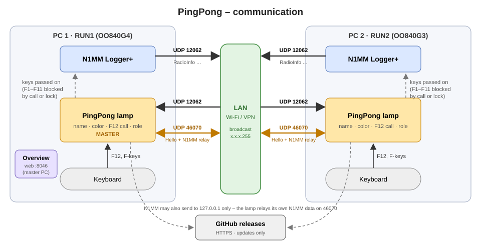
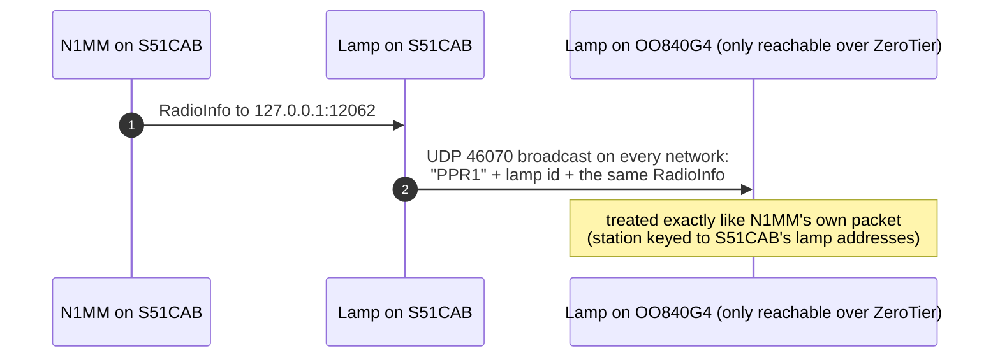
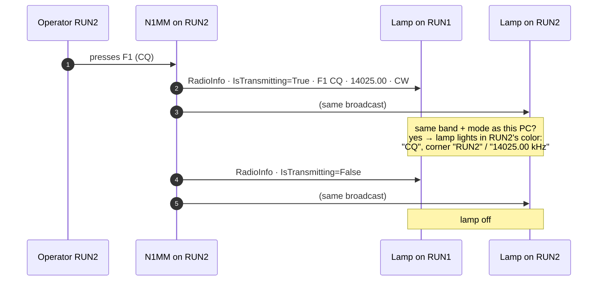
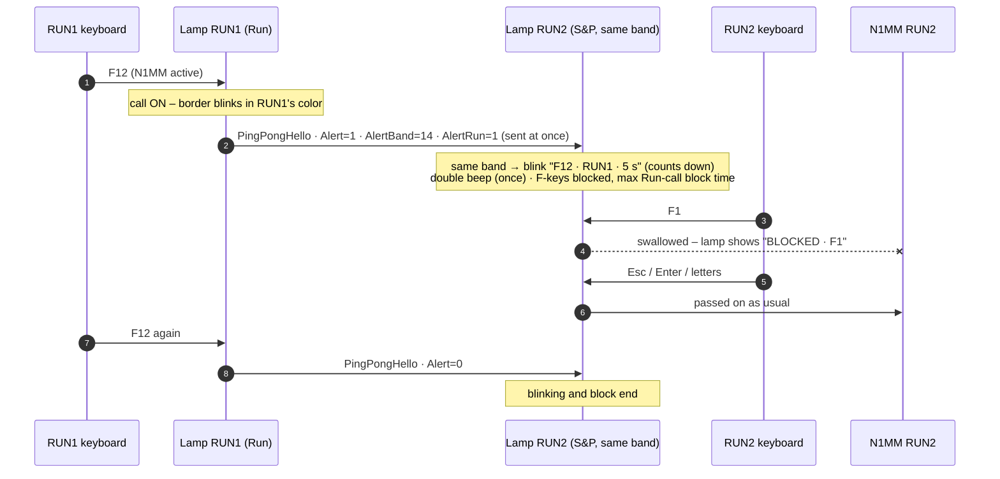
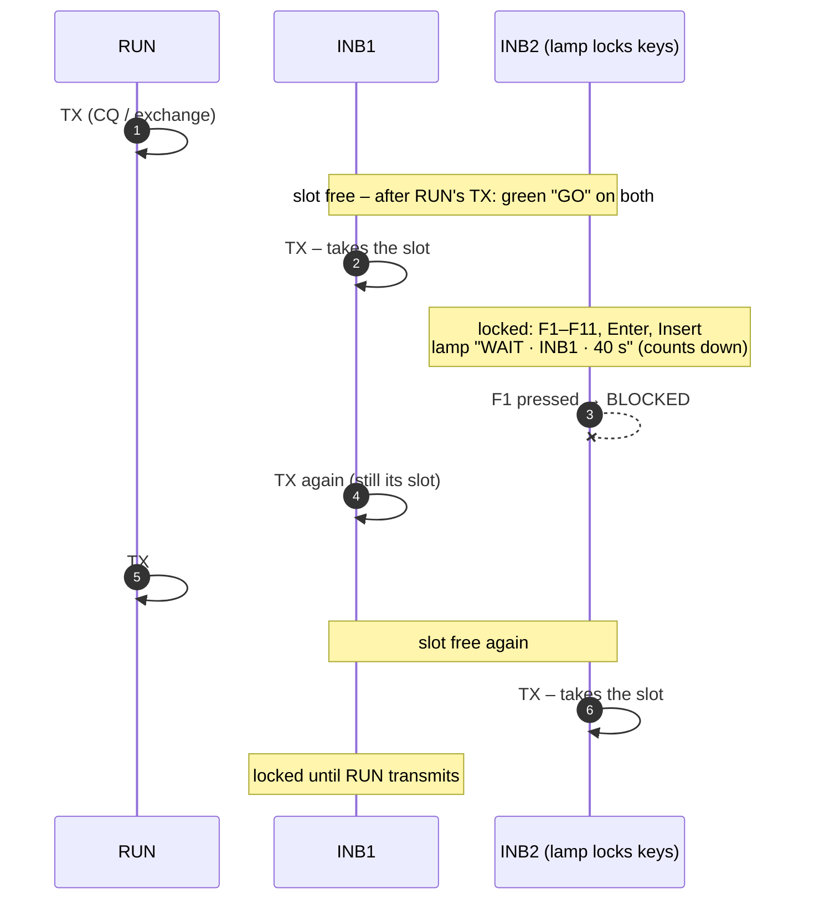
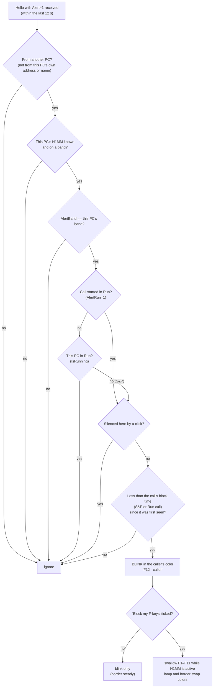
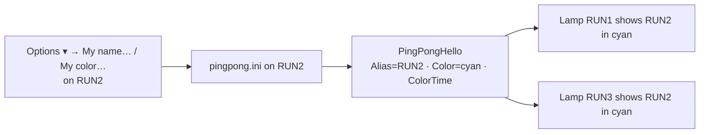
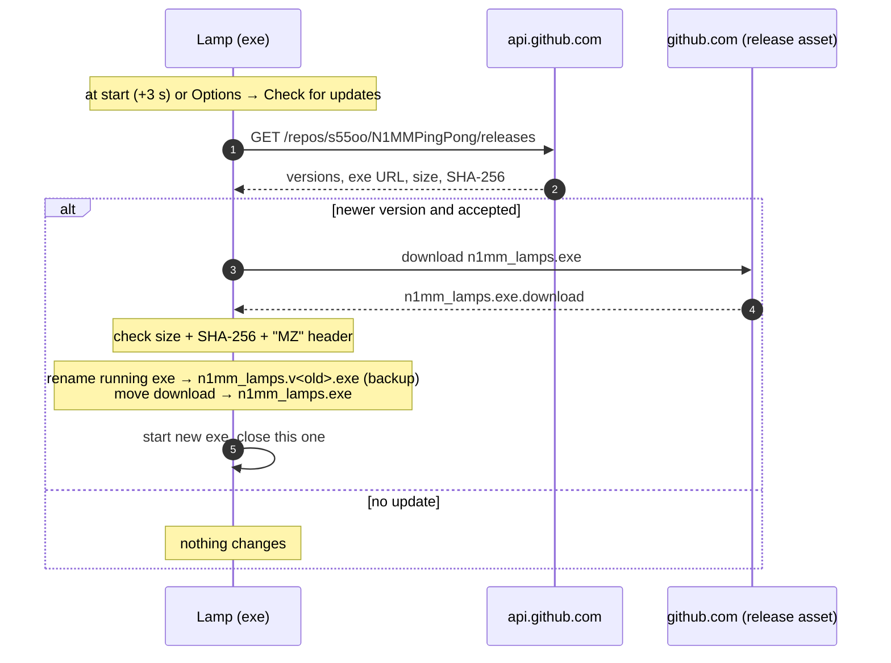

# PingPong – how it communicates

This page describes what travels between N1MM Logger+, the PingPong lamps,
the PingPong Overview and GitHub, and how a lamp decides what to show. For
using the programs see the [README](../README.md); in short:
[SUMMARY](SUMMARY.md).

- [1. Overview](#1-overview)
- [2. Ports and messages](#2-ports-and-messages)
- [3. A transmission on the lamp](#3-a-transmission-on-the-lamp)
- [4. F12 call and F-key block](#4-f12-call-and-f-key-block)
- [5. Ping-pong lock](#5-ping-pong-lock)
- [6. Does this lamp blink and block?](#6-does-this-lamp-blink-and-block)
- [7. Names and colors](#7-names-and-colors)
- [8. Updates](#8-updates)
- [9. Timings](#9-timings)
- [10. Where things can break](#10-where-things-can-break)

---

## 1. Overview

Every operating PC runs **N1MM Logger+** and one **PingPong lamp**; the
master PC can also run the **PingPong Overview**. There are five kinds of
traffic:

1. **N1MM → lamp** (UDP 12062): N1MM's own External Broadcast; the
   **Radio** line on N1MM's **Broadcast Data** tab must include
   `127.0.0.1:12062`, e.g. `127.0.0.1:12060 127.0.0.1:12062` (other
   programs keep N1MM's usual 12060; the other lines need no change).
   See the [screenshot](n1mm-broadcast-data.png).
   PingPong only listens to it and never sends anything on this port.
2. **Lamp ↔ lamp** (UDP 46070): small `PingPongHello` messages with each
   PC's name, color, role, F12 call and state – the **master** adds the
   automatic colors, both F12 block times and ping-pong lock on/off – and
   a **copy of each PC's own
   N1MM `RadioInfo`** (relay), so every lamp sees every station on any
   network the lamps share (LAN, ZeroTier, VPN), even if N1MM only sends to
   `127.0.0.1`.
3. **Lamp → GitHub** (HTTPS): only to check for and download updates.
4. **Overview** (optional, on the master PC): `pingpong_overview.exe`
   listens on UDP 46070 – hellos and relays – and shows all stations in a
   window and as a web page on **TCP 8046** (`http://<master PC>:8046`)
   for any browser. It never opens N1MM's ports. From the relayed `RadioInfo` it
   also counts, per station, which function key started each transmission
   (`FunctionKeyCaption` at the moment `IsTransmitting` turns True).
   Its only messages to the lamps (`PPC1` + JSON on UDP 46070, obeyed only if
   they come from the master PC's address, once per `id`):
   `{"cmd": "update"}` – **Update all lamps** (lamps v1.60+);
   `{"cmd": "pingpong", "value": "1"/"0"}` – ping-pong lock on/off, applied
   by the master lamp, which passes it on in its hello (`<PingPong>`);
   `{"cmd": "ping", "seq": n}` – every 5 min: each lamp (v1.73+) answers at
   once with `PPP1` + JSON `{"seq", "id", "host"}` straight back to the
   Overview's sending port – the round-trip time in ms;
   `{"cmd": "test"}` – **Test all lamps**: each lamp (v1.72+) flashes its
   name and role for 3 s;
   `{"cmd": "restart"}` / `{"cmd": "stop"}` – **Emergency**: every lamp
   (v1.71+) starts itself again / closes (the Overview asks twice first);
   `{"cmd": "setup", "pcs": {"<pc name>": {"alias", "color"}}, "master":
   {"block_time", "block_time_run", "pingpong", "pp_limit"}}` – **Restore
   setup**: each lamp (v1.81+) takes the entry of its own Windows computer
   name; the master's lamp also takes `master` and passes it on in its hello.
5. **Phone lamp** (optional, every lamp): a web page on **TCP 8047**
   (`http://<this PC>:8047`, `/state` = JSON) with the lamp as it is now
   and one tile per band. Read only; the lamp builds the state only while
   a phone asks for it.

On its own PC the lamp also **watches the keyboard** while N1MM is the
active window: F12 starts or ends a call, during a call it can swallow
F1–F11 before N1MM gets them, and the ping-pong lock also swallows Enter
and Insert. It also reads one value from N1MM's settings file:
`IsNetworkMaster` (read only).



The broadcasts go to the subnet broadcast address of every network
adapter of the PC (e.g. `192.168.178.255`) and to `255.255.255.255`, so
all PCs on the LAN, Wi-Fi or VPN receive them.

---

## 2. Ports and messages

| Port | Direction | Sent by | Content |
|---|---|---|---|
| **UDP 12062** | N1MM → lamp (and LAN, if a subnet broadcast is added) | N1MM (External Broadcast) | XML: `RadioInfo`, `contactinfo`, `spot`, `dynamicresults` … |
| **UDP 46070** | lamp ↔ lamp, Overview → lamps | PingPong | XML: `PingPongHello`; `PPR1` + lamp id + N1MM `RadioInfo` (relay); `PPC1` + JSON command from the Overview (update, ping-pong lock on/off, lamp test, ping, emergency restart/stop, restore setup); `PPP1` + JSON ping answer (lamp → Overview, unicast) |
| HTTPS 443 | lamp / Overview → `api.github.com`, `github.com` | PingPong | release list, exe download |
| TCP 8046 | browser → master PC | PingPong Overview | web page with the live table (`/`, `/data.json`) |
| TCP 8047 | phone / browser → any lamp PC | PingPong lamp | phone lamp (`/`, `/state`), read only |

Port 46070 is deliberately far away from N1MM's ports: N1MM parses
anything that arrives on its multi-computer port (12070), and older
PingPong versions that used 12070 made N1MM show an
`IndexOutOfRangeException`.

### What PingPong reads from N1MM's `RadioInfo`

| Field | Used for |
|---|---|
| `StationName` | station name (unless the PC set **My name**) |
| `Freq` | band (group) and the kHz text in the lamp corner; units of 10 Hz (`1402500` = 14025.00 kHz) |
| `Mode` | mode group: CW, RTTY, SSB (`USB`/`LSB` count as SSB) |
| `IsTransmitting` | lamp on/off – True only while **N1MM itself** transmits |
| `FunctionKeyCaption` | the big text, `Fx` prefix removed – only for keys that start a transmission |
| `IsRunning` | Run or S&P – the ping-pong role (Run = RUN, S&P = INB) and who an F12 call reaches |

N1MM sends `RadioInfo` immediately on every change and repeats it every
10 seconds. The packet's source address tells PingPong which PC it came
from.

### `PingPongHello` (lamp → lamps)

```xml
<PingPongHello>
  <Id>3F2A9C01B7E4</Id>            <!-- random per lamp start -->
  <Host>OO840G4</Host>             <!-- Windows computer name -->
  <Version>1.76</Version>
  <Ips>192.168.178.55,192.168.56.1</Ips>
  <LocalN1MM>true</LocalN1MM>      <!-- this PC's N1MM heard in the last 10 s -->
  <Color>gold</Color>              <!-- My color, empty = automatic -->
  <ColorTime>1793109953.699</ColorTime>
  <Alert>1</Alert>                 <!-- F12 call on -->
  <AlertBand>14</AlertBand>
  <AlertTime>1793127941.120</AlertTime>
  <Status>N1MM 14 CW from 192.168.178.55, Run; …</Status>
  <Alias>RUN1</Alias>              <!-- My name -->
  <Role>RUN</Role>                 <!-- ping-pong role: RUN, INB or empty -->
  <N1MMMaster>1</N1MMMaster>       <!-- this PC's N1MM is network master: 1/0/empty -->
  <Started>1793824377.488</Started><!-- when this lamp started -->
  <Colors>pc:oo840g3=red;pc:oo840g4=light blue;…</Colors>  <!-- only from the master -->
  <BlockTime>30</BlockTime>        <!-- S&P-call block time in s (1-30), only from the master -->
  <AlertRun>0</AlertRun>           <!-- 1 = the call was started in Run: reaches all stations -->
  <BlockTimeRun>5</BlockTimeRun>   <!-- Run-call block time in s (1-30), only from the master -->
  <PingPong>1</PingPong>           <!-- ping-pong lock 1 = on / 0 = off, only from the master -->
  <PPLimit>40</PPLimit>            <!-- ping-pong release time in s (0-40, 0 = only RUN frees), only from the master -->
  <Problems>no N1MM data on UDP 12062</Problems>  <!-- what is wrong on this PC, "|"-separated -->
  <Urgent>0</Urgent>               <!-- 1 = urgent call (Shift+F2 or Shift+F4) on -->
  <UrgentBand>14</UrgentBand>      <!-- band and mode of the urgent call -->
  <UrgentMode>CW</UrgentMode>
  <UrgentTime>1793127941.120</UrgentTime>
</PingPongHello>
```

A lamp sends this every **3 s**, and **at once** when something changes
(F12 or urgent call, name, role, the master's settings). A lamp not heard
for **12 s** is considered gone.

### Relay: a lamp passes on its own N1MM's data



- Only packets from the lamp's **own** N1MM are relayed (never relays of
  relays), and only `RadioInfo`.
- If N1MM's broadcast from that PC also arrives directly (same LAN) within
  the last 15 s, the relayed copy is ignored.
- Every address of a PingPong PC maps to one station, so a PC seen over
  both LAN and ZeroTier is listed once.

---

## 3. A transmission on the lamp



If nothing arrives from the transmitting station for **5 s** (`--stale`),
the lamp turns off by itself, in case the "off" packet was lost.

---

## 4. F12 call and F-key block

A call's reach depends on the caller's mode **when F12 is pressed**
(sent as `<AlertRun>`):

| Caller in | Reaches on its band | Lasts |
|---|---|---|
| S&P | S&P stations only | S&P-call block time (`<BlockTime>`, default 30 s) |
| Run | all other stations, Run and S&P | Run-call block time (`<BlockTimeRun>`, default 5 s) |

Example: RUN1 runs, RUN2 searches & pounces on the same band. RUN1 wants
RUN2 to hold off.



An S&P station cannot start a call while another PC's call runs on its
band (silenced or not): F12 there is ignored and the lamp shows
`BLOCKED · F12`. A Run station can always call.

The call also ends on the receiving lamp when its operator **clicks the
lamp**, changes band or (S&P call) switches to Run, when the calling lamp
has not been heard for 12 s, and in any case after the call's **block
time** (1–30 s each, set on the master): then blinking and block stop
everywhere and the caller's call switches itself off.

### Urgent call (Shift+F2 / Shift+F4)

Shift+F2 or Shift+F4 in N1MM is passed on to N1MM (F2/F4 fires as usual) **and** turns
on `<Urgent>` with this PC's band and mode. Every lamp on the **same band
and mode** – Run or S&P – flashes fast (0.15 s, caller color ↔ white),
shows `<caller name> · <F2/F4 caption>` (e.g. `RUN1 · QRL?`, `MSG` until the
caption arrives; no sound) and puts this above everything else on
the lamp. No keys are blocked.

The urgent call lasts **while the caller's F2/F4 message is transmitted**:
the caller's lamp watches its own N1MM's `IsTransmitting` and sends
`<Urgent>0` at once when that transmission ends. If no transmission
starts within 3 s, it ends too. No other time limit (a lamp not heard for 12 s is dropped anyway); a click silences it on
one PC.

---

## 5. Ping-pong lock

One RUN and inband stations (INB1, INB2) on the same band take turns, like
a doubles match: RUN transmits, and in RUN's listening gap **one** inband
station transmits. Each PC's role always comes from its N1MM's
`IsRunning` – Run = RUN, S&P = INB – and is sent in the hello (`<Role>`,
at once when it changes).

Every lamp sees every transmission start (N1MM's `IsTransmitting`
changing to True, directly or relayed), so each INB lamp keeps the same "slot"
for its band without any extra messages:

- **RUN starts transmitting** → the slot is free (new period). With
  several RUN stations on the band, each of them does this – all RUNs are
  equal and never locked.
- **An INB starts transmitting** while the slot is free → it holds the
  slot. Any other INB on that band is locked until RUN transmits again.
- The slot holder may transmit again in the same period.
- **RUN stops transmitting** (`IsTransmitting` back to False) and the
  slot is free → each INB lamp on that band shows a green **GO** for 3 s,
  until an INB takes the slot.
- No RUN on the band, RUN silent for the release time (`<PPLimit>`, set on
  the master, 0–40 s, default 40; 0 = never by time), or the lock switched **OFF**
  on the master (`<PingPong>0`, also from the Overview's button) → no lock.



This is the rule; N1MM's own interlock still prevents two transmissions
overlapping in time.

---

## 6. Does this lamp blink and block?

Every 0.12 s each lamp checks every call it has heard:



"Same PC" is decided by the address the hello came from (or the PC name),
not by comparing all addresses – virtual adapters such as VirtualBox's
`192.168.56.1` exist on every PC.

---

## 7. Names and colors

Each PC owns its **name** (`Alias`) and **color**; the other lamps only
display them.



- A name already used by another PC is refused when you type it.
- A color already chosen by another PC is greyed out; a custom color too
  similar to one is refused.
- If two PCs still claim the same color, every lamp applies the same rule:
  **the earliest `ColorTime` wins** (ties: PC name). The other PC falls back
  to an automatic color and shows `color … is taken`.
- **Automatic colors come from the master.** The master is the PC whose
  N1MM is network master (each lamp reads `IsNetworkMaster` from its own
  `N1MM Logger.ini` and sends it as `<N1MMMaster>`); if none is, the lamp
  with the earliest `<Started>`. The master sends its list in `<Colors>`
  (keys `pc:<windows name>` for lamp PCs, `n1mm:<station name>` for the
  rest); every lamp uses it. Colors stay with a station while it is
  there, also across a master change, because the new master starts from
  the list it last received.

---

## 8. Updates



Two more ways to update:

- **Update all lamps** (Overview on the master PC): a `PPC1` command
  `{"cmd": "update"}` makes every lamp (v1.60+) run the same steps at once,
  without asking on the PCs. A lamp that is already current does nothing.
- **The Overview updates itself** the same way with
  `pingpong_overview.exe` from the release (asks first; backup
  `pingpong_overview.v<old>.exe`).

Releases themselves are made by GitHub Actions: every push to `main` with
a new `__version__` (in `pingpong_version.py`) first runs the automated
tests, then builds both exes on a clean Windows runner, scans them with
Defender and publishes release `v<version>` with notes from
`releases/v<version>.md`.

---

## 9. Timings

| What | Value |
|---|---|
| Lamp-to-lamp hello | every 3 s, immediately on any change (calls, name, role, master settings) |
| N1MM relay | each own `RadioInfo` at once; direct N1MM data preferred if seen in the last 15 s |
| Lamp considered gone | 12 s without a hello |
| Network adapters re-read | every 30 s |
| Check for other programs on the lamp's port (12062) | every 30 s (Windows' UDP table) |
| Lamp off if transmitting station goes silent | 5 s (`--stale`) |
| Blink rhythm | 0.4 s on / 0.4 s off; urgent call 0.15 s |
| Urgent call time | while the caller's F2/F4 transmits; ends if no TX starts within 3 s |
| Call sound | double beep once when a call starts blinking (option) |
| Window place saved | 1.5 s after the lamp was moved, and on close |
| F12 call time | S&P call: 1–30 s, default 30 (`<BlockTime>`); Run call: 1–30 s, default 5 (`<BlockTimeRun>`); both set on the master. Then blinking and block end on the receivers and the caller's call switches off |
| Ping-pong release time | 0–40 s without a RUN transmission, default 40, set on the master (`<PPLimit>`); 0 = only RUN frees the slot |
| Station drops off the status line | 60 s without packets |
| Keyboard watcher re-installed | every 10 s (Windows drops slow hooks silently) |
| Update check | lamp: once, 3 s after start; Overview: 3 s after start, then every 30 min |
| Ping (Overview → lamps) | every 5 min (first 10 s after start) and on **Ping now**; answers later than 2 s count as lost; over 500 ms = slow |

---

## 10. Where things can break

| Symptom | Likely link | Check |
|---|---|---|
| Lamp never lights | N1MM → lamp (12062) | N1MM *Broadcast Data* → *Radio* ticked, its line must include `127.0.0.1:12062`; band/mode supported |
| Red `⚠ UDP 12062 also used by …` | N1MM → lamp (12062) | another program on the PC listens on the lamp's port and gets N1MM's `127.0.0.1` packets instead – give one of them another port (`--port`) and add it to N1MM's Broadcast Data → Radio line |
| `RUN2: N1MM not reaching here` | N1MM RUN2 → this lamp | the Broadcast Data → Radio line in RUN2's N1MM |
| Other lamps never react to F12 | lamp ↔ lamp (46070) | firewall on the receiving PC (**Options ▾ → Allow PingPong in Windows Firewall…**), same version on all PCs; **Diagnostics** shows what each lamp reports |
| `PC5: no PingPong heard – firewall?` | lamp ↔ lamp (46070) | N1MM data arrives but no other lamp does: this PC's firewall blocks 46070 |
| `RUN2: v1.67 – update it` | – | every lamp compares `<Version>` from the hellos with its own; Overview: **Update all lamps…** |
| F12 does nothing locally | keyboard → lamp | N1MM must be the active window; if N1MM runs as administrator, run PingPong as administrator too |
| A station seen only over a VPN is missing | relay (46070) | **Share my N1MM with other lamps** on on that PC; firewall allows UDP 46070 on that network |
| Colors / F12 block time differ between PCs | master (46070) | only one lamp's title says `MASTER`; all PCs on the same version |
| Red `⚠ TWO MASTERS: …` | master (46070) | only the master sends `<BlockTime>`: if two lamps do, they don't hear each other – check the firewall on both |
| Red `⚠ N1MM master on … and …` | N1MM settings | two N1MMs report `IsNetworkMaster=True` – check N1MM's Network Status |
| Ping-pong lock never locks | 12062 + roles | lock **ON** on the master; a station in **Run** (role RUN) on the same band; check the Role column in the Overview |
| INB stays locked although RUN transmits | 12062 / relay | RUN's messages must be N1MM-started (not paddle/PTT); RUN's data must reach the INB (Diagnostics shows `RUN transmits – slot free`) |
| No update offered | lamp → GitHub | internet access to github.com |
