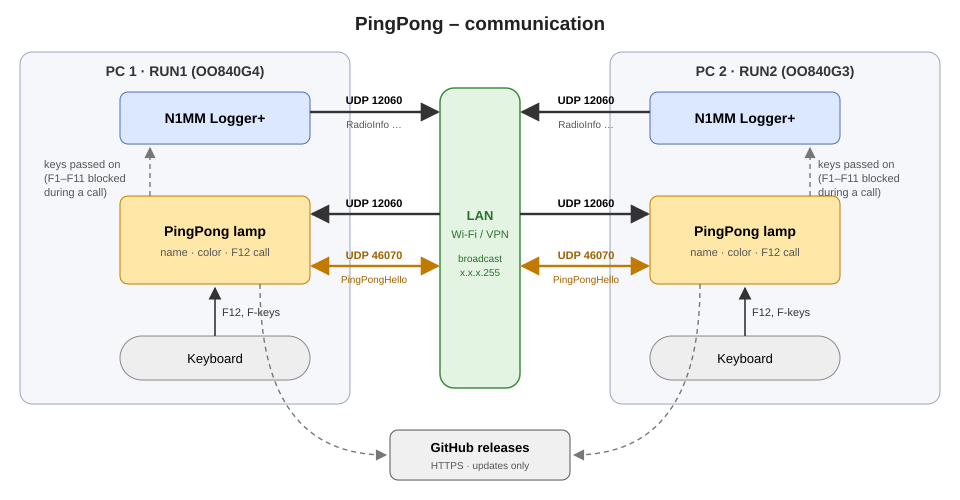
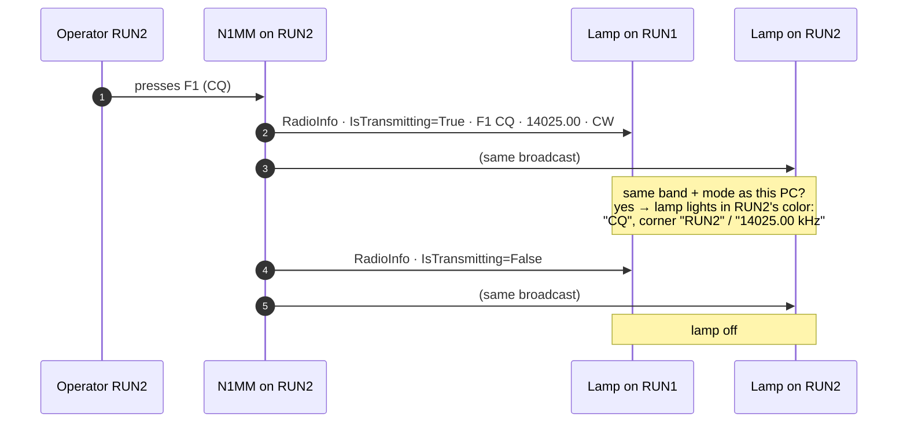
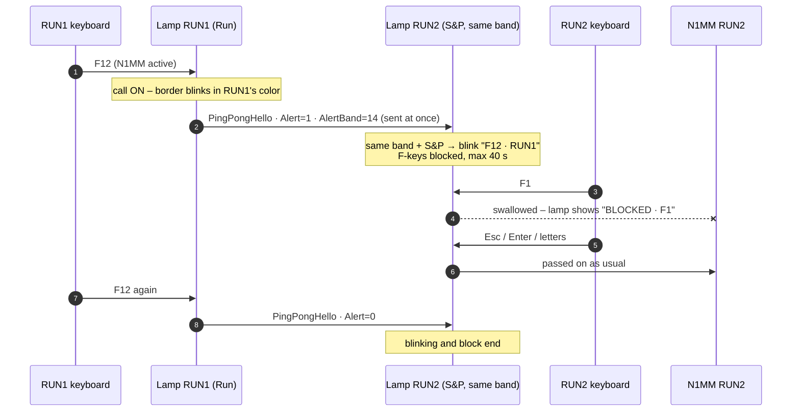
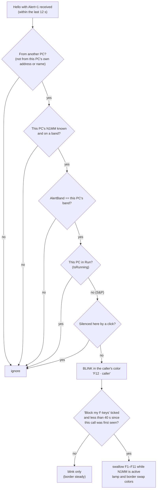
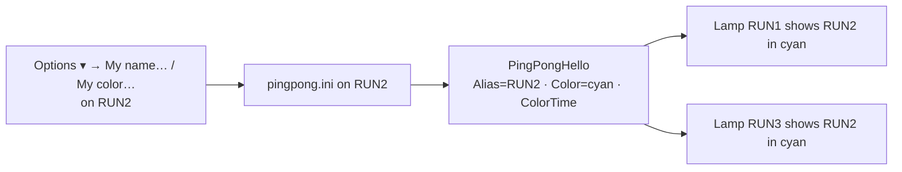
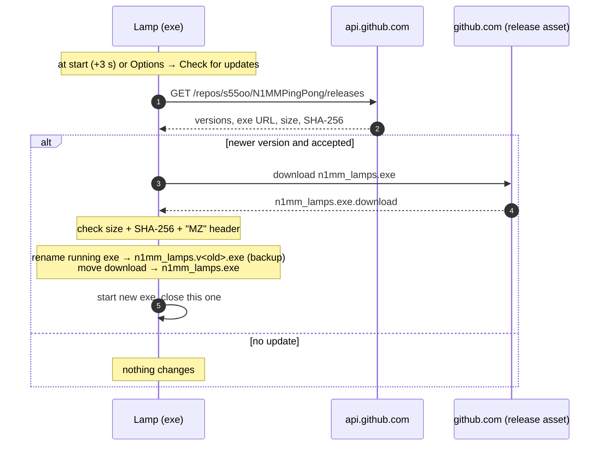

# PingPong – how it communicates

This page describes what travels between N1MM Logger+, the PingPong lamps
and GitHub, and how a lamp decides what to show. For using the lamp see the
[README](../README.md).

- [1. Overview](#1-overview)
- [2. Ports and messages](#2-ports-and-messages)
- [3. A transmission on the lamp](#3-a-transmission-on-the-lamp)
- [4. F12 call and F-key block](#4-f12-call-and-f-key-block)
- [5. Does this lamp blink and block?](#5-does-this-lamp-blink-and-block)
- [6. Names and colors](#6-names-and-colors)
- [7. Updates](#7-updates)
- [8. Timings](#8-timings)
- [9. Where things can break](#9-where-things-can-break)

---

## 1. Overview

Every operating PC runs **N1MM Logger+** and one **PingPong lamp**. There
are three kinds of traffic:

1. **N1MM → all lamps** (UDP 12060): N1MM's own External Broadcast.
   PingPong only listens to it and never sends anything on this port.
2. **Lamp ↔ lamp** (UDP 46070): small `PingPongHello` messages with each
   PC's name, color, F12 call and state.
3. **Lamp → GitHub** (HTTPS): only to check for and download updates.

On its own PC the lamp also **watches the keyboard** while N1MM is the
active window: F12 starts or ends a call, and during a call it can swallow
F1–F11 before N1MM gets them.



The broadcasts go to the subnet broadcast address of every network
adapter of the PC (e.g. `192.168.178.255`) and to `255.255.255.255`, so
all PCs on the LAN, Wi-Fi or VPN receive them.

---

## 2. Ports and messages

| Port | Direction | Sent by | Content |
|---|---|---|---|
| **UDP 12060** | N1MM → everyone | N1MM (External Broadcast) | XML: `RadioInfo`, `contactinfo`, `spot`, `dynamicresults` … |
| **UDP 46070** | lamp ↔ lamp | PingPong | XML: `PingPongHello` |
| HTTPS 443 | lamp → `api.github.com`, `github.com` | PingPong | release list, exe download |

Port 46070 is deliberately far away from N1MM's ports: N1MM parses
anything that arrives on its multi-computer port (12070), and older
PingPong versions that used 12070 made N1MM show an
`IndexOutOfRangeException`.

### What PingPong reads from N1MM's `RadioInfo`

| Field | Used for |
|---|---|
| `StationName` | station name (unless the PC set **My name**) |
| `Freq` | band (group) and the kHz text in the lamp corner; units of 10 Hz (`1402500` = 14025.00 kHz) |
| `Mode` | mode group: CW, RTTY, SSB (`USB`/`LSB` count as SSB) |
| `IsTransmitting` | lamp on/off – True only while **N1MM itself** transmits |
| `FunctionKeyCaption` | the big text, `Fx` prefix removed – only for keys that start a transmission |
| `IsRunning` | Run or S&P – decides whether an F12 call applies |

N1MM sends `RadioInfo` immediately on every change and repeats it every
10 seconds. The packet's source address tells PingPong which PC it came
from.

### `PingPongHello` (lamp → lamps)

```xml
<PingPongHello>
  <Id>3F2A9C01B7E4</Id>            <!-- random per lamp start -->
  <Host>OO840G4</Host>             <!-- Windows computer name -->
  <Version>1.34</Version>
  <Ips>192.168.178.55,192.168.56.1</Ips>
  <LocalN1MM>true</LocalN1MM>      <!-- this PC's N1MM heard in the last 10 s -->
  <Color>gold</Color>              <!-- My color, empty = automatic -->
  <ColorTime>1793109953.699</ColorTime>
  <Alert>1</Alert>                 <!-- F12 call on -->
  <AlertBand>14</AlertBand>
  <AlertTime>1793127941.120</AlertTime>
  <Status>N1MM 14 CW from 192.168.178.55, Run; …</Status>
  <Alias>RUN1</Alias>              <!-- My name -->
</PingPongHello>
```

A lamp sends this every **3 s**, and **at once** when F12 is pressed or the
name changes. A lamp not heard for **12 s** is considered gone.

---

## 3. A transmission on the lamp



If nothing arrives from the transmitting station for **5 s** (`--stale`),
the lamp turns off by itself, in case the "off" packet was lost.

---

## 4. F12 call and F-key block

RUN1 runs, RUN2 searches & pounces on the same band. RUN1 wants RUN2 to
hold off.



The call also ends on the receiving lamp when its operator **clicks the
lamp**, changes band or switches to Run, when the calling lamp has not
been heard for 12 s, and the F-key block alone ends after **40 s**.

---

## 5. Does this lamp blink and block?

Every 0.12 s each lamp checks every call it has heard:



"Same PC" is decided by the address the hello came from (or the PC name),
not by comparing all addresses – virtual adapters such as VirtualBox's
`192.168.56.1` exist on every PC.

---

## 6. Names and colors

Each PC owns its **name** (`Alias`) and **color**; the other lamps only
display them.



- A name already used by another PC is refused when you type it.
- A color already chosen by another PC is greyed out; a custom color too
  similar to one is refused.
- If two PCs still claim the same color, every lamp applies the same rule:
  **the earliest `ColorTime` wins** (ties: PC name). The other PC falls back
  to an automatic color and shows `color … is taken`.
- Stations whose PC runs no lamp keep their N1MM name and an automatic
  color.

---

## 7. Updates



Releases themselves are made by GitHub Actions: every push to `main` with
a new `__version__` builds the exe on a clean Windows runner and publishes
release `v<version>` with notes from `releases/v<version>.md`.

---

## 8. Timings

| What | Value |
|---|---|
| Lamp-to-lamp hello | every 3 s, immediately on F12 / name change |
| Lamp considered gone | 12 s without a hello |
| Network adapters re-read | every 30 s |
| Lamp off if transmitting station goes silent | 5 s (`--stale`) |
| Blink rhythm | 0.4 s on / 0.4 s off |
| F-key block limit | 40 s after the call is first seen |
| Station drops off the status line | 60 s without packets |
| Keyboard watcher re-installed | every 10 s (Windows drops slow hooks silently) |
| Update check | once, 3 s after start |

---

## 9. Where things can break

| Symptom | Likely link | Check |
|---|---|---|
| Lamp never lights | N1MM → lamp (12060) | N1MM *Broadcast Data*, *RadioInfo*, Broadcast Address; band/mode supported |
| `RUN2: N1MM not reaching here` | N1MM RUN2 → this lamp | RUN2's Broadcast Address |
| Other lamps never react to F12 | lamp ↔ lamp (46070) | firewall on the receiving PC, same version on all PCs; **Diagnostics** shows what each lamp reports |
| F12 does nothing locally | keyboard → lamp | N1MM must be the active window; if N1MM runs as administrator, run PingPong as administrator too |
| No update offered | lamp → GitHub | internet access to github.com |
