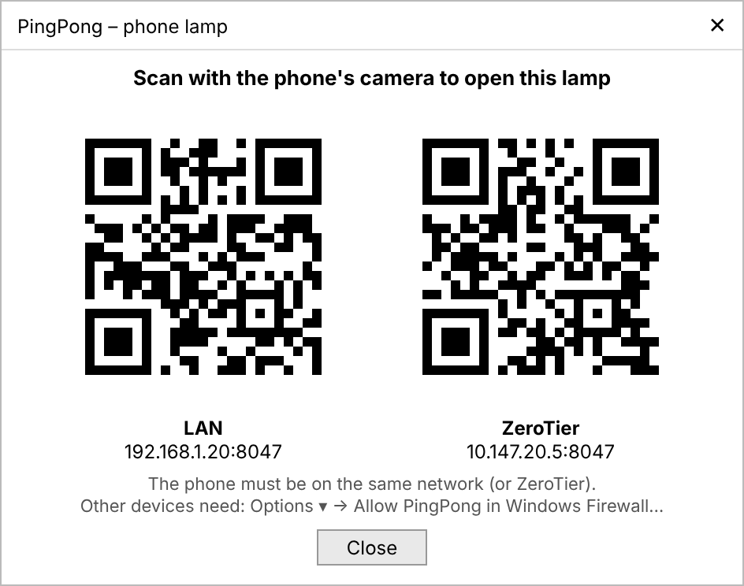
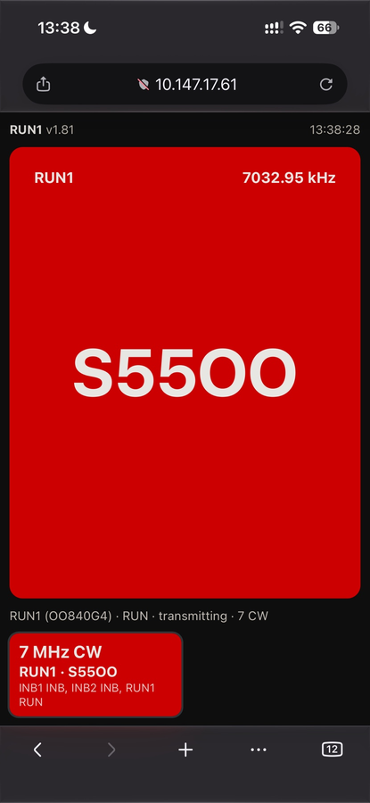
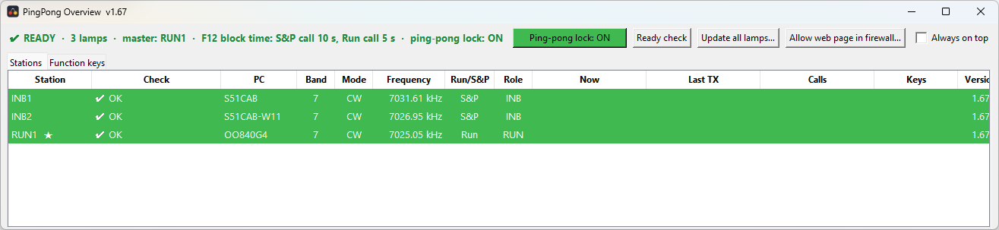
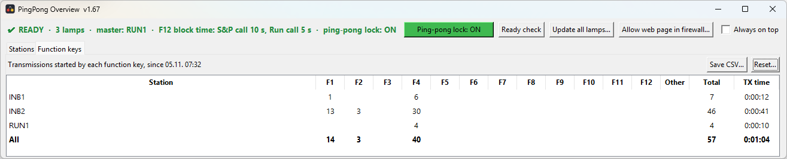
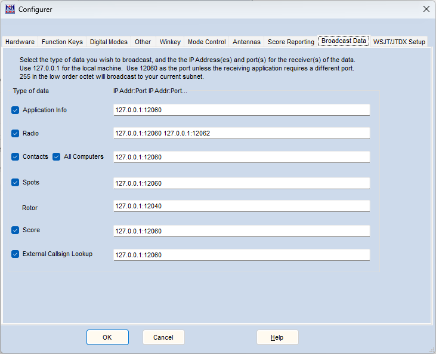

# PingPong – summary

**PingPong** is a small set of Windows programs for multi-operator
contest stations running **N1MM Logger+**. It shows every operator, at a
glance, **which station on their band is transmitting**. It helps the
stations on one band **take turns**, and it lets them **warn each other
without transmitting**. Made by **S55OO** with AI assistance; main use:
**CQ WW**.

It needs nothing besides N1MM: no extra hardware and no server. It
reads N1MM's own network broadcast, and the PCs find each other by
themselves on the LAN, over Wi-Fi or over a VPN such as ZeroTier.

| Program | Where | What it is |
|---|---|---|
| **Lamp** – `n1mm_lamps.exe` | every operating PC | small always-on-top window that lights up in the color of the station that transmits |
| **Overview** – `pingpong_overview.exe` | the master PC | live table of all stations, also as a web page for phones and tablets |
| **Watcher** – `PingPong.bat` | when needed | detailed list of every N1MM packet, for checking a setup |

Download: [latest release](https://github.com/s55oo/N1MMPingPong/releases/latest).
Full manual: [README](../README.md). How it talks on the network:
[COMMUNICATION](COMMUNICATION.md). For the operators: a one-page
[cheat sheet](CHEATSHEET.md) ([PDF to print](PingPong-cheat-sheet.pdf)); for the
captain a one-page [quick chart](PingPong-captain-chart.pdf).

---

## 1. The lamp (on every operating PC)

### See who transmits
- The lamp **lights up exactly while a station transmits** on the same
  band and mode as this PC (1.8–28 MHz; CW, RTTY, SSB). It shows:
  - the station's color;
  - the message, e.g. `CQ` or `5NN TU`;
  - who is sending, e.g. `RUN1`, in big letters top left, and the
    frequency.
- Each PC has a **name** (`RUN1`, `INB2` …) and a **color** that are the
  same on every lamp. The master gives out automatic colors, and each
  PC can choose its own.
- The line under the lamp lists every station: band, mode, Run/S&P and
  role.
- The **title bar** shows the N1MM port and version, e.g.
  `PingPong - MASTER UDP 12062 v1.98`.
- **Compact mode** (Shift+F): just the lamp, with no window frame.
- **Options ▾** is grouped: name and color at the top, then Display, Calls
  and keys, Ping-pong and F12 times, Network and Updates.
- **Lamp size** normal / large / extra large, and **night mode** with
  dimmed colors.
- **Phone lamp:** every lamp is also a web page on **TCP 8047** – the same
  big lamp on a phone or tablet, plus a tile per band showing who
  transmits. The top line of the lamp shows the address to open, e.g.
  `192.168.1.20:8047 · 10.147.17.3:8047` (LAN, plus ZeroTier if the PC
  is on it). **Options ▾ → Phone lamp QR code…** shows it as a QR code to
  scan with the phone.

  

  

### Warn other operators without transmitting
- **F12 call:** "hold off, please".
  - Pressed in **S&P**: the **S&P** stations on your band blink in your
    color, for the S&P call time (default 30 s).
  - Pressed in **Run**: **all** stations on your band blink, for the
    Run call time (default 5 s).
  - Both times are set on the master.
  - Optionally their **F1–F11 are blocked** while the call is on.
  - The caller and the receivers see a countdown.
  - An S&P station cannot start a call while another call runs on its
    band.
- **Urgent call: Shift+F2 / Shift+F4.** N1MM sends the F2/F4 message as
  usual. At the same time, every station on the **same band and mode**
  flashes fast with your name and the message, e.g. `RUN1 · QRL?`.
  The flashing lasts exactly as long as the message is transmitted.
- **Priority call: Ctrl+F2 / Ctrl+F4.** Your message goes out **alone**:
  every station on the same band and mode that is transmitting gets an
  Esc (its message stops), their send keys are held, and half a second
  later your lamp sends F2/F4 in N1MM. Flashes like the urgent call.

### Ping-pong lock (taking turns on one band)
- Each PC's role comes **automatically from N1MM**: Run = **RUN**,
  S&P = **INB** (inband) – nothing to set.
- After RUN transmits, the **first INB that transmits takes the slot**.
  Every other INB is locked (F1–F11, Enter and Insert) until RUN
  transmits again.
- **Switched on or off for all PCs on the master** – off means nobody is
  locked and every station may transmit without priority.
- When RUN's transmission ends, the inband lamps show a white **GO** on
  the grey idle lamp (visual only). The locked lamp shows `WAIT · INB1 · 32 s`; the
  lock releases itself after the release time set on the master
  (0–40 s, default 40 s; 0 = only RUN frees it).
- An inband lamp warns when there is no RUN on its band (lock off).
- Several RUN stations are allowed, and all of them are treated the same.

### Keeps itself working
- **Master:** follows N1MM's network master. If none is set, the lamp
  started first is master.
- **Shares this PC's N1MM data** with the other lamps, so stations are
  seen even if N1MM only sends to `127.0.0.1` or the PCs only meet over
  ZeroTier.
- **Network password (optional):** set once on the master; every other
  lamp notices it and asks for it (red line – click, type, checked at
  once; removing it on the master is offered to the others the same
  way). Every lamp message is then signed (HMAC-SHA256 with a time
  stamp) and messages from anyone without it are ignored – nobody else on
  the LAN or ZeroTier can fake calls or stop the lamps.
- **Warnings on the lamp:**
  - other PCs on a different version;
  - two masters;
  - a firewall blocking the lamps (with a one-click firewall rule);
  - no data from its own N1MM, or another program on its port;
  - network password needed, different, or removed by the master
    (`🔒` / `🔓` – click the line).
- **Updates** from GitHub: by itself, from **Options ▾ → Updates**, or for all
  PCs at once from the Overview. It can switch back to the previous
  version.
- Errors go to `pingpong_error.log`; the lamp never stops because of
  one.

---

## 2. The Overview (on the master PC)

Started from the **master's lamp** (**Options ▾ → Open PingPong Overview…**);
the lamp downloads it if it is missing. One Overview per PC.

*(Screenshot from v1.68; the second button row is now **Update all
lamps…**, **Settings ▾** and **Statistics ▾**.)*

- **One live table** of every station:
  - name (★ = master), PC and version;
  - band, mode, frequency, Run/S&P and role;
  - what it is transmitting right now, and its last message;
  - F12, urgent and priority calls;
  - blocked keys, and who holds the ping-pong slot.
- **Web page** at `http://<master PC>:8046`: the same table in any
  browser on the network, e.g. the captain's phone. Nothing to install
  there.
  **Settings ▾ → Allow web page in Windows Firewall…** opens TCP 8046;
  once the rule exists the status line shows `web 0.0.0.0:8046`.
- **Ready check:** before the contest every row is **green** (ready) or
  **dark red**, with the reason:
  - not heard;
  - old version;
  - no N1MM data;
  - no master, or two;
  - keyboard watcher not running;
  - problems the lamp reports itself: another program on N1MM's port,
    errors, no RUN on its band.

  Each row switches to normal colors when that station starts operating.
- **Ping-pong lock ON/OFF:** one button switches the lock for all PCs.
- **Ping:** every 5 minutes (or **Ping now**) the round-trip time to every
  lamp in ms; no answer or over 500 ms turns the row red.
- **Test all lamps:** every lamp flashes its own name and role for 3 s.
- **Alarm – station not heard:** a station that has been operating and is
  not heard for 30 s (PC crashed, lamp closed, cable out) turns its row
  red, the status line flashes `🔔 NOT HEARD: INB2` and it beeps until
  **Silence alarm** – or until the station is back.
- **Right click → Remove from the list:** a station that is no longer heard
  (PC off or disconnected) leaves the table and stops the alarm; it comes
  back by itself when its lamp is heard again.
- **Settings ▾:**
  - **save** every PC's name and color (by Windows computer name) plus the
    master's F12 times and ping-pong settings to a file, and **restore**
    them to all lamps before the next contest;
  - the **network password**, the **web page in Windows Firewall** and
    **Always on top**.
- **Event log:** a contest timeline in `pingpong_events.csv` (calls, waits,
  lamps lost or restarted, setting changes, commands).
- **Contest report…** (Activity tab or Statistics ▾): after the contest, one page (HTML, printable) with
  TX time and share per station, function keys, waits, calls, ping, alarms,
  TX minutes per hour and the notable events.
- **Emergency ▾:** restart or stop all lamps – asks twice (Yes, then
  typing `YES` + Enter).
- **Update all lamps:** one button. It shows how many lamps are behind
  (`Update 2 lamps…` / `All lamps v1.98 ✔`). Every lamp that needs it
  downloads the newest release and restarts, and no one has to touch the
  other PCs. Lamps accept commands only from the master PC.
- **Statistics ▾:** reset the counters now, or **planned at the contest
  start** (e.g. Saturday 01:00) – so nobody has to remember it.
- **Function key statistics:** per station, how many transmissions F1–F12
  started, plus total TX time. Kept over restarts, with CSV export.
- **Activity:** per station, how often and how long it waited
  (ping-pong), F12 and urgent calls, and a chart of TX minutes per hour.

  
- **Updates itself** when a new release is out (asks first).
- It listens to the lamps and sends them only its own commands (update,
  ping-pong lock, test, ping, restore setup, emergency) – from the master
  PC only. It never touches N1MM's port, so it is safe to run next to the
  master's lamp.

---

## 3. A contest weekend with PingPong

1. **Setup, once per PC:**
   - In N1MM: **Config → Configure Ports, Mode Control, Winkey, etc… →
     Broadcast Data**. Tick **Radio** and set its line to
     `127.0.0.1:12060 127.0.0.1:12062`. Only the Radio line needs 12062;
     leave the others as they are.

     
   - Start the lamp.
   - Set **My name**. The ping-pong role follows N1MM by itself
     (Run = RUN, S&P = INB).
   - Turn on **F12 call** and, where wanted, **Block my F-keys**.
2. **Before the start, on the master PC:**
   - Start the Overview from the master's lamp: **Options ▾ → Open
     PingPong Overview…** (only on the master; it downloads the Overview
     if it is missing).
   - **Update all lamps…**.
   - Wait until every row is **green** (`✔ READY`).
   - **Statistics ▾ → Reset at contest start…** – proposes the next
     Saturday 01:00 local (CQ WW start); the counters go to zero by
     themselves at that moment, and the yellow button shows the plan.
3. **During the contest:**
   - Lamps show who is on the air.
   - F12 asks S&P stations to hold off. F12 from Run stops everyone for
     a few seconds.
   - Shift+F2 / Shift+F4 sends an urgent message to everyone on the band;
     Ctrl+F2 / Ctrl+F4 first stops the others' transmissions.
   - The ping-pong lock keeps RUN and the inband stations taking turns.
   - The captain watches the Overview, also on a phone.
4. **After the contest:** **Contest report…** on the Activity tab (and
   **Save CSV…** if you want the raw numbers).

Print the [operator cheat sheet](PingPong-cheat-sheet.pdf) for every
operating position.

---

## 4. Limits – what it does not do

- It only knows about transmissions **N1MM itself starts** (function keys,
  Enter/Insert messages). Keying by **paddle, microphone PTT or
  footswitch** is not reported by N1MM, so it is not shown or blocked.
- Blocking stops **key presses in N1MM** only, not mouse clicks or
  hardware keying. It prevents mistakes; it is **not a hardware
  interlock**. N1MM's own interlock still applies.
- Stations whose PC runs no lamp appear on the lamps only if their N1MM
  broadcast reaches the LAN, and they never appear in the Overview.
- **Windows only.**

---

## 5. How it is built (for the curious)

- **Python and Tkinter**, packed into one exe per program with
  PyInstaller. The build's starter code is compiled from source, the
  exes are not compressed, and they carry Windows version information.
  A Defender scan must be clean before a release is published. Every
  release carries `SHA256SUMS.txt` (also in its notes); updates are only
  installed when the download's SHA-256 matches.
- **Network:**
  - N1MM's broadcast to the lamp on **UDP 12062**, which PingPong only reads;
  - lamp-to-lamp messages on **UDP 46070**;
  - the Overview's web page on **TCP 8046**;
  - each lamp's phone page on **TCP 8047**;
  - GitHub, over HTTPS, for updates only.
- **Code:**
  - `n1mm_lamps.py`: the window;
  - `pingpong_lamp_menu.py`, `pingpong_lamp_update.py`,
    `pingpong_lamp_phone.py`: the lamp's Options menu, updates and phone lamp;
  - `pingpong_rules.py`: the rules;
  - `pingpong_net.py`: the network;
  - `pingpong_common.py`: shared constants and parsing;
  - `pingpong_keys.py`: the keyboard watcher;
  - `pingpong_update.py`: updates;
  - `pingpong_phone.py`: the phone lamp page;
  - `pingpong_qr.py`: QR codes for the phone lamp address;
  - `pingpong_overview.py` (+ `_common`, `_admin`, `_stats`, `_web`):
    the Overview;
  - `pingpong_report.py`: the after-contest report;
  - `pingpong_version.py`: the version number.
- **Automated tests** (`tests/`, 182 tests; the Windows-only parts are checked on GitHub's
  Windows runner) run on every push before
  anything is built. A failing test means no release.
- Releases are built and published automatically by GitHub Actions
  when the version number changes.
